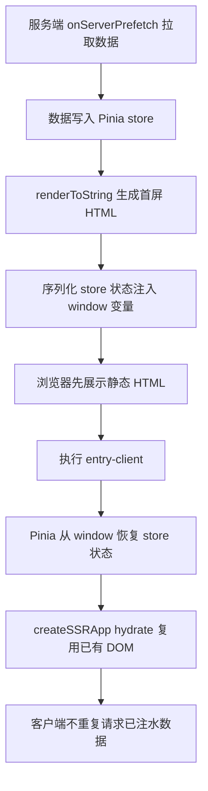

## V3-115：首屏优化有哪些组合拳（路由级分割 + SSR 取舍）？
**答**：
- 基础项：路由级懒加载让首屏只加载当前页代码；manualChunks 把框架代码与重依赖（echarts/xlsx）单独分包，利于长效缓存。
- 关键项：图片压缩与 webp、关键接口预请求、骨架屏降低感知延迟。
- SSR 取舍：内容型站点（SEO + 首屏时间敏感）值得上 SSR；重交互中后台收益小、成本高（服务端、运维、复杂度），通常 CSR + 骨架屏即可。
- 度量先行：用 Lighthouse/性能面板确认瓶颈是 JS 体积、接口还是渲染，再决定投入。

```typescript
// vite.config.ts —— 首屏代码分割组合
import { defineConfig } from "vite";

export default defineConfig({
  build: {
    rollupOptions: {
      output: {
        // 框架代码稳定不变，单独分包享受长效缓存
        manualChunks: {
          vendor: ["vue", "vue-router", "pinia"],
          echarts: ["echarts"], // 重依赖单独分包，首屏不加载，用到时再拉
        },
      },
    },
    chunkSizeWarningLimit: 800,
  },
});

// 路由级分割（router/routes.ts）：
// { path: "/order", component: () => import("@/views/Order.vue") }
// 每个页面一个 chunk，首屏只拉当前路由的代码

// 重组件局部懒加载（用到时才加载）：
// const Chart = defineAsyncComponent(() => import("./BigChart.vue"));
```

## 第二十八章 SSR 与同构

SSR 数据预取、hydration 不匹配、第三方库兼容、Nuxt3 渲染模式与流式渲染，构成同构开发的完整链路。


