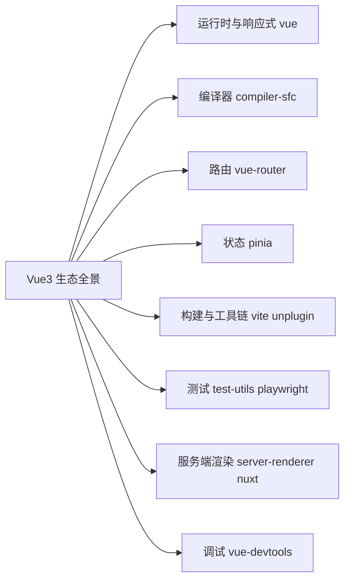

## V3-120：流式 SSR 如何与 Suspense 配合？
**答**：
- 传统 SSR 要等整棵树渲染完才返回；流式 SSR 用 renderToNodeStream 分块写出，浏览器更早收到并开始渲染。
- async setup 的组件包在 Suspense 内，形成异步边界：边界未就绪时先推送 fallback（骨架屏）。
- Vue3 的流式渲染会先输出外壳与已就绪部分，异步边界解析完成后再补送对应片段并自动注水衔接。
- Vue3.5 的懒水合（`defineAsyncComponent` + `hydrate` 选项，内置 `hydrateOnVisible/hydrateOnIdle/hydrateOnInteraction/hydrateOnMediaQuery` 策略）与 Nuxt3 的 `defineLazyHydrationComponent` 宏是同一机制的上层封装。

```javascript
// server.js —— 流式 SSR 与 Suspense 的配合
import { createSSRApp } from "vue";
import { renderToNodeStream } from "vue/server-renderer";
import { createApp } from "./app"; // 工厂函数：每次请求创建独立实例

app.get("*", (req, res) => {
  res.setHeader("Content-Type", "text/html; charset=utf-8");
  res.write('<!DOCTYPE html><div id="app">'); // 先把外壳推送出去

  const { app: vueApp } = createApp({ url: req.url });
  const stream = renderToNodeStream(vueApp);

  stream.pipe(res, { end: false }); // 分块写出：已就绪内容立即到达浏览器
  stream.on("end", () => res.end("</div>"));
});

// App.vue 端配合（示意）：
// <Suspense>
//   <PageWithAsyncSetup />   <!-- async setup 组件 = 异步边界 -->
//   <template #fallback>骨架屏</template>  <!-- 未就绪时先推送骨架屏 -->
// </Suspense>
// 异步边界解析完成后，对应 HTML 片段随后补送，浏览器自动衔接
```

## 第二十九章 工程与生态

工程组织、TypeScript 配合、unplugin 生态、测试分层、错误监控、迁移、defineModel、Vapor、微前端与 Electron，最后收束为一张 Vue 生态全景图。



## 追问（补充）

**追问**：

1. Vue 的流式 SSR 支持 React 那种乱序补丁吗？ → 不完全。Vue 按 Suspense 边界顺序输出，先发 fallback，边界就绪后再补送对应片段与替换脚本；不支持任意乱序拼接，边界划分因此要按"慢数据在后"的顺序设计。
2. 流式输出时组件里的 onMounted 会执行吗？ → 不会。服务端不跑 onMounted，只在客户端 hydrate 后才触发；服务端准备数据要用 setup 里的 await 或 onServerPrefetch，否则首屏拿到的是空数据。
3. 用 hydrateOnInteraction 懒水合，用户点击前的事件会丢吗？ → 实现上会先在容器上做事件代理拦截，触发水合后再派发，所以正常不丢；但水合失败或组件抛错时这次交互会静默丢失，需要补一个兜底提示。
