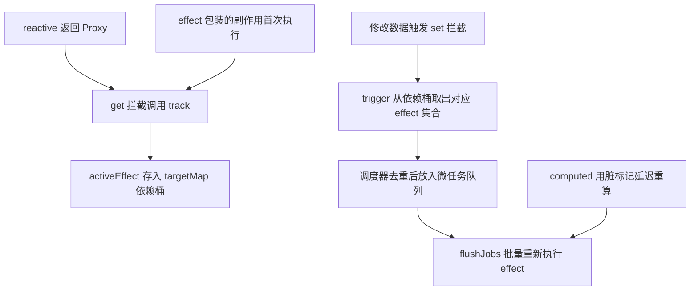

## V3-135：如何收束 Vue3 的生态知识体系？
**答**：
- 记忆锚点：一套核心（reactive 响应式 + compiler 编译优化）+ 两个官方邻域（vue-router、pinia）+ 一圈工程设施（Vite、unplugin、test-utils、devtools）+ 两个延伸方向（SSR/Nuxt、custom renderer）。
- 复习时按层自检：响应式原理 → 组件模型 → 路由与状态 → 构建与测试 → 服务端与跨端，每层都能举出代表 API 与一个实战场景。
- 面试表达建议：先报架构全景，再按追问深入某层细节，避免陷入孤立知识点。
- 持续跟进渠道：vuejs/core 的 RFC 与发布日志、VueConf、官方博客的版本公告。

```typescript
// ecosystem.ts —— 一张“包职责地图”，按层复习与自检
export const ecosystemMap = {
  // 核心：响应式与运行时
  runtime: {
    vue: "入口：createApp、组合式 API、内置组件",
    "@vue/reactivity": "reactive/ref/effect 响应式内核",
    "@vue/runtime-dom": "DOM 平台操作与 patch",
  },
  // 编译：SFC 与模板优化
  compiler: {
    "@vue/compiler-sfc": "单文件组件解析：template/script/style",
    "@vue/compiler-dom": "模板编译：patchFlag、静态提升、块树",
  },
  // 路由与状态
  routerAndState: {
    "vue-router": "createRouter、守卫、动态路由",
    pinia: "defineStore、getter/action、插件体系",
  },
  // 工程设施
  tooling: {
    vite: "构建与开发服务器",
    "unplugin-auto-import": "API 自动导入",
    "unplugin-vue-components": "组件按需注册",
    "@vue/test-utils": "组件单元测试",
    "vue-devtools": "状态、时间线、组件审查",
  },
  // 延伸方向
  advanced: {
    "@vue/server-renderer": "SSR 渲染到字符串/流",
    nuxt: "SSR 框架化封装：路由、数据、渲染模式",
    "@vue/compat": "Vue2 渐进迁移兼容层",
  },
};
```

## 第三十章 源码级简化实现

手写简化版响应式系统是 Vue3 面试的压轴题：用最少的代码讲清 reactive、effect、track、trigger、computed、watch、nextTick 的核心链路，再口述与源码的差距。


