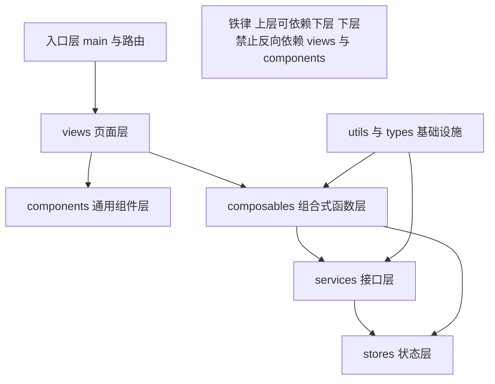

## V3-153：如何封装一个时间轴调度器来编排复杂进场动画？
**答**：
- 复杂编排的本质是"步骤串行 + 步骤间延迟 + 可取消"，用 async/await 实现比嵌套 setTimeout 可读得多。
- useTimeline 提供 run(steps) 与 cancel()；每步是 { run, after }，after 表示与上一步的间隔。
- 取消通过 token 标志位实现：sleep 与 run 检查标志，取消后抛出可捕获的错误，组件卸载时调用 cancel 清理。
- 适用于大屏进场、引导流程（onboarding）、多阶段营销页等"多元素按节奏依次出现"的场景。

```typescript
// composables/useTimeline.ts —— 步骤编排器：串行 + 间隔 + 可取消
type Step = () => void | Promise<void>;
interface TimelineStep {
  run: Step;
  after?: number; // 与上一步的间隔 ms
}

export function useTimeline() {
  let cancelled = false;

  const sleep = (ms: number) =>
    new Promise<void>((resolve, reject) => {
      setTimeout(() => (cancelled ? reject(new Error("timeline cancelled")) : resolve()), ms);
    });

  async function run(steps: TimelineStep[]) {
    cancelled = false;
    for (const step of steps) {
      if (cancelled) throw new Error("timeline cancelled");
      if (step.after) await sleep(step.after); // 步骤间节奏
      await step.run();                        // 串行执行
    }
  }

  const cancel = () => (cancelled = true); // 组件卸载时调用，防止动画泄漏
  return { run, cancel };
}

// 用法：大屏进场 = 标题滑入 -> 卡片依次淡入 -> 图表绘制
// import { onMounted, onUnmounted } from "vue";
// const { run, cancel } = useTimeline();
// onMounted(async () => {
//   try {
//     await run([
//       { run: () => animateIn(titleEl), after: 0 },
//       { run: () => Promise.all(cards.map((c, i) => animateIn(c, i * 80))), after: 200 },
//       { run: () => renderChart(), after: 150 },
//     ]);
//   } catch { /* 被 cancel 或组件卸载，静默结束 */ }
// });
// onUnmounted(cancel);
```

## 第三十三章 大型项目架构

大型 Vue3 项目的架构题考察"分层意识 + 落地细节"：目录分层与依赖方向、MPA/微前端、主题与国际化、接口与错误处理体系。答题套路：先给全景图，再讲每层的边界与关键实现。


