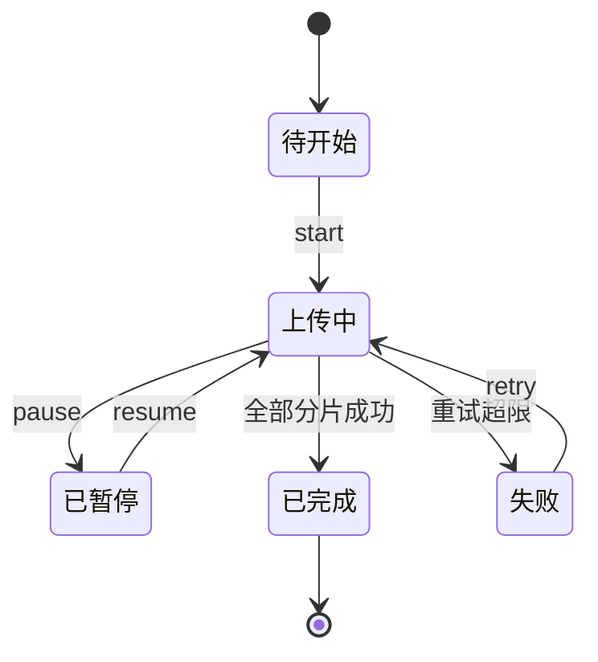

## V3-165：文件上传队列管理如何设计（并发限制 + 断点续传状态机）？
**答**：
- 每个文件是一个状态机：待开始 → 上传中 → 已暂停/失败/已完成；分片是执行单元，记录已成功的分片号支持断点续传。
- 并发控制：全局并发上限（如 3），队列调度器从待上传文件取任务填满窗口；单文件内分片也可并行。
- 断点续传：上传前先向服务端探查已收到的分片（或本地记录），跳过已完成分片；暂停即停止调度，不销毁状态。
- 错误处理：分片级重试（指数退避），超过阈值整个文件标失败；大文件建议 hash 预检做秒传。



```typescript
// src/services/uploader.ts —— 上传队列：状态机 + 并发窗口 + 断点续传
type FileState = "pending" | "uploading" | "paused" | "failed" | "done";

const CHUNK_SIZE = 5 * 1024 * 1024; // 5MB 分片
const MAX_CONCURRENCY = 3;          // 全局并发窗口

class UploadTask {
  state: FileState = "pending";
  progress = 0;
  private doneChunks = new Set<number>();
  private retryMap = new Map<number, number>();

  constructor(public file: File, private onChange: () => void) {}

  get chunks() {
    return Math.ceil(this.file.size / CHUNK_SIZE);
  }

  async start() {
    if (this.state === "uploading" || this.state === "done") return;
    this.state = "uploading";
    this.onChange();
    // 断点续传：先问服务端已收到哪些分片
    const uploaded = await fetch(`/api/upload/status?name=${this.file.name}`).then((r) => r.json());
    (uploaded.doneChunks as number[]).forEach((i) => this.doneChunks.add(i));

    for (let i = 0; i < this.chunks; i++) {
      if (this.state !== "uploading") return; // 暂停/失败退出循环，状态保留
      if (this.doneChunks.has(i)) continue;   // 跳过已传分片
      const ok = await this.uploadChunk(i);
      if (!ok) { this.state = "failed"; this.onChange(); return; }
      this.progress = Math.round((this.doneChunks.size / this.chunks) * 100);
      this.onChange();
    }
    await fetch("/api/upload/merge", {
      method: "POST",
      headers: { "Content-Type": "application/json" },
      body: JSON.stringify({ name: this.file.name, total: this.chunks }),
    });
    this.state = "done";
    this.onChange();
  }

  private async uploadChunk(index: number): Promise<boolean> {
    const retries = this.retryMap.get(index) ?? 0;
    const blob = this.file.slice(index * CHUNK_SIZE, (index + 1) * CHUNK_SIZE);
    const form = new FormData();
    form.append("chunk", blob);
    form.append("index", String(index));
    try {
      const resp = await fetch("/api/upload/chunk", { method: "POST", body: form });
      if (!resp.ok) throw new Error();
      this.doneChunks.add(index);
      return true;
    } catch {
      if (retries >= 3) return false;             // 重试超限
      this.retryMap.set(index, retries + 1);
      await new Promise((r) => setTimeout(r, 500 * 2 ** retries)); // 指数退避
      return this.uploadChunk(index);
    }
  }

  pause() { if (this.state === "uploading") { this.state = "paused"; this.onChange(); } }
  resume() { if (this.state === "paused" || this.state === "failed") this.start(); }
}

export class UploadQueue {
  tasks: UploadTask[] = [];
  private running = 0;

  add(file: File) {
    const task = new UploadTask(file, () => this.dispatch()); // 状态变化时重新调度
    this.tasks.push(task);
    this.dispatch();
  }
  // 并发窗口调度：始终维持 MAX_CONCURRENCY 个上传中
  private dispatch() {
    while (this.running < MAX_CONCURRENCY) {
      const next = this.tasks.find((t) => t.state === "pending" || t.state === "failed");
      if (!next) break;
      this.running++;
      next.start().finally(() => { this.running--; this.dispatch(); });
    }
  }
}

// 用法
// const queue = new UploadQueue();
// <input type="file" multiple @change="(e) => e.target.files && [...e.target.files].forEach((f) => queue.add(f))">
```
