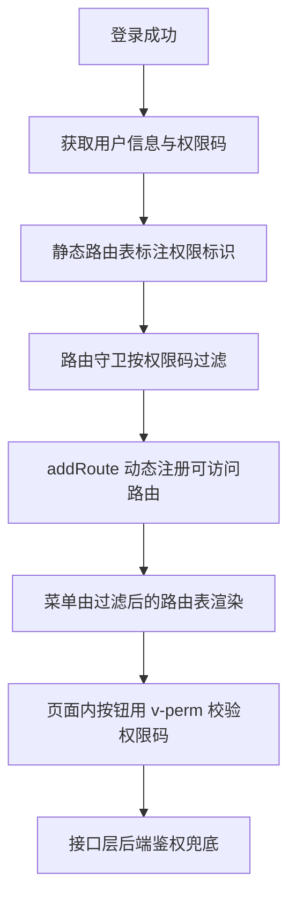

## V3-182：设计一个中后台管理系统的前端架构（布局/权限/菜单/表格/表单体系）？
**答**：
- 权限体系四层：路由级（动态 addRoute）-> 菜单级（过滤后的路由表渲染）-> 按钮级（v-perm 权限码）-> 接口级（后端兜底），前端权限只是体验优化。
- 布局体系：Layout 容器（侧边栏 + 顶栏 + 标签页 + router-view）与业务页面彻底分离，页面只关心内容。
- 表格体系：ProTable 二次封装（columns 配置 + 搜索区自动生成 + 分页内置），配合 useTableQuery 状态机（见 V3-162）。
- 表单体系：表单 schema 化（见 V3-184），中后台 80% 的 CRUD 表单用配置生成，复杂表单才手写组件。
- 工程层：动态路由 + keep-alive 白名单、微前端预留（子应用挂载点）、主题/i18n/错误处理沿用第三十三、三十六章方案。



```typescript
// src/router/permission.ts —— 动态路由生成（架构核心一环）
import { router, staticRoutes } from "./index";
import { useUserStore } from "@/stores/user";

// 静态路由表：component 用动态 import，meta 标注权限
export const asyncRoutes: RouteRecordRaw[] = [
  {
    path: "/system",
    component: () => import("@/layouts/Blank.vue"),
    meta: { roles: ["admin"] },
    children: [
      {
        path: "user",
        component: () => import("@/views/system/User.vue"),
        meta: { title: "用户管理", icon: "user", perms: ["system:user:list"] },
      },
      {
        path: "role",
        component: () => import("@/views/system/Role.vue"),
        meta: { title: "角色管理", perms: ["system:role:list"] },
      },
    ],
  },
];

let registered = false;
router.beforeEach(async (to) => {
  const user = useUserStore();
  if (!user.token) return { path: "/login", query: { redirect: to.fullPath } };

  if (!registered) {
    await user.fetchProfile(); // 拿到 roles 与 perms
    // 过滤：递归比对 meta.roles / meta.perms
    const allowed = filterRoutes(asyncRoutes, user);
    allowed.forEach((r) => router.addRoute(r));
    registered = true;
    return { ...to, replace: true }; // 重新进入一次，命中新注册的路由
  }
  if (to.matched.length === 0) return "/404";
  return true;
});

function filterRoutes(routes: RouteRecordRaw[], user: ReturnType<typeof useUserStore>): RouteRecordRaw[] {
  return routes
    .filter((r) => !r.meta?.roles || (r.meta.roles as string[]).some((role) => user.roles.includes(role)))
    .map((r) => (r.children ? { ...r, children: filterRoutes(r.children, user) } : r));
}

// ProTable 封装契约（views 里直接用）：
// <ProTable :columns="columns" :request="orderApi.list" searchable>
//   <template #toolbar><el-button v-perm="'order:create'">新建</el-button></template>
// </ProTable>
```
