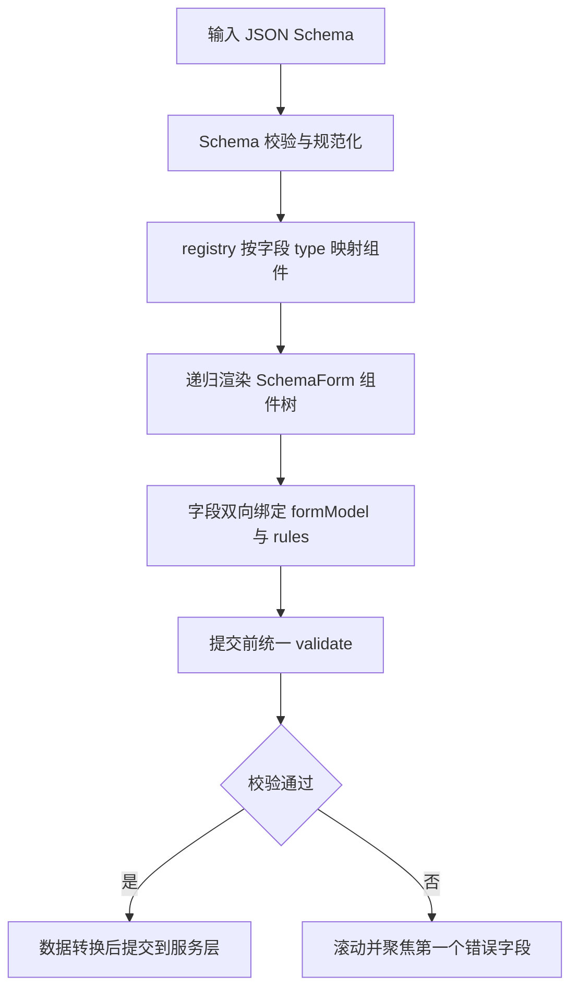

## V3-184：设计一个表单引擎（schema 到组件树到校验到提交）？
**答**：
- 数据模型：JSON Schema 描述字段（type、label、rules、options、visible 表达式），引擎职责是"schema -> 组件树 -> formModel -> validate -> submit"。
- 组件映射表 registry：type 字符串到组件的 Map，业务可注册自定义组件，保持引擎开放封闭。
- 联动三件套：visible/disabled 用表达式或函数求值（响应依赖收集自动更新），required 动态化，异步 options 加载。
- 提交链：submit 前统一 validate -> 转换（格式化、trim）-> 交给服务层；错误定位到第一个非法字段滚动聚焦。



```vue
<!-- components/SchemaForm.vue —— 表单引擎核心 -->
<script setup lang="ts">
import { reactive, computed, ref, type Component, type PropType } from "vue";
import { ElInput, ElSelect, ElDatePicker } from "element-plus";

interface FieldSchema {
  field: string;
  label: string;
  type: "input" | "select" | "date";
  rules?: Array<{ required?: boolean; message: string }>;
  options?: Array<{ label: string; value: unknown }>;
  visible?: (model: Record<string, unknown>) => boolean; // 联动表达式
  disabled?: (model: Record<string, unknown>) => boolean;
}

const props = defineProps({
  schema: { type: Array as PropType<FieldSchema[]>, required: true },
  submitApi: { type: Function as PropType<(m: Record<string, unknown>) => Promise<unknown>>, required: true },
});

// 组件注册表：开放封闭，业务可扩展自定义 type
const registry: Record<FieldSchema["type"], Component> = {
  input: ElInput,
  select: ElSelect,
  date: ElDatePicker,
};

// formModel 由 schema 初始化，字段全部可响应
const model = reactive<Record<string, unknown>>(
  Object.fromEntries(props.schema.map((f) => [f.field, undefined]))
);
const errors = ref<Record<string, string>>({});
const submitting = ref(false);

// 联动：visible 是函数，依赖 model 的字段变化自动重算（computed 响应式）
const visibleFields = computed(() => props.schema.filter((f) => f.visible?.(model) ?? true));

async function submit() {
  // 1. 校验：required 规则归一执行
  const errs: Record<string, string> = {};
  for (const f of visibleFields.value) {
    const empty = model[f.field] === undefined || model[f.field] === "";
    if (f.rules?.some((r) => r.required) && empty) {
      errs[f.field] = f.rules.find((r) => r.required)!.message;
    }
  }
  errors.value = errs;
  if (Object.keys(errs).length) {
    // 2. 定位第一个错误字段
    document.querySelector(`[data-field="${Object.keys(errs)[0]}"]`)?.scrollIntoView({ behavior: "smooth" });
    return;
  }
  // 3. 提交
  submitting.value = true;
  try {
    await props.submitApi({ ...model });
  } finally {
    submitting.value = false;
  }
}
</script>

<template>
  <form @submit.prevent="submit">
    <div v-for="f in visibleFields" :key="f.field" class="row" :data-field="f.field">
      <label>{{ f.label }}</label>
      <component
        :is="registry[f.type]"
        v-model="model[f.field]"
        :options="f.options"
        :disabled="f.disabled?.(model)"
        :placeholder="`请输入${f.label}`"
      />
      <span v-if="errors[f.field]" class="err">{{ errors[f.field] }}</span>
    </div>
    <button type="submit" :disabled="submitting">提交</button>
  </form>
</template>

<!-- schema 配置示例（调用方）：
     const schema: FieldSchema[] = [
       { field: "type", label: "工单类型", type: "select", rules: [{ required: true, message: "必选" }],
         options: [{ label: "故障", value: 1 }, { label: "咨询", value: 2 }] },
       { field: "desc", label: "描述", type: "input",
         visible: (m) => m.type === 1, // 联动：只有故障单显示
         rules: [{ required: true, message: "描述必填" }] },
     ] -->
```
