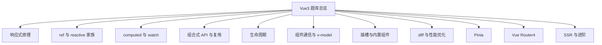
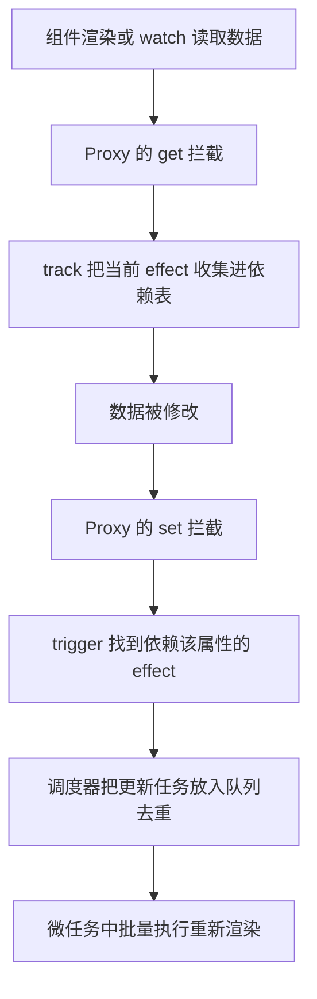

# Vue3 前端面试题库

本文件收录 200 道 Vue3 面试题，编号 V3-001 ~ V3-200，覆盖 Vue3 相对 Vue2 的变化、Proxy 响应式原理、ref/reactive 家族、computed/watch/watchEffect、组合式 API 与逻辑复用、生命周期、组件通信、v-model、插槽、内置组件、diff 算法与 key、异步组件、自定义指令、插件机制、Pinia、Vue Router4、性能优化、SSR 与 Nuxt、custom renderer、defineProps 泛型与 VueUse，以及组件设计实战、组合式函数库、状态/表单/路由工程、UI 交互模式、性能实战、SSR 同构、源码级简化实现、指令系统、过渡动画、大型项目架构、测试工程与 Vue3 新特性深用等实战专题。每题均配有与题目一一对应的代码示例，SFC 统一使用 `<script setup>` 组合式 API 风格，不包含任何算法题。

## 目录

- 第一章 Vue3 概览与响应式原理（V3-001 ~ V3-008）
- 第二章 ref 与 reactive 家族（V3-009 ~ V3-014）
- 第三章 computed、watch 与 watchEffect（V3-015 ~ V3-020）
- 第四章 组合式 API 与逻辑复用（V3-021 ~ V3-024）
- 第五章 生命周期（V3-025 ~ V3-027）
- 第六章 组件通信（V3-028 ~ V3-033）
- 第七章 v-model 双向绑定（V3-034 ~ V3-035）
- 第八章 插槽 Slot（V3-036 ~ V3-037）
- 第九章 内置组件 Teleport、Suspense、KeepAlive（V3-038 ~ V3-041）
- 第十章 diff 算法与 key（V3-042 ~ V3-044）
- 第十一章 异步组件（V3-045）
- 第十二章 自定义指令（V3-046 ~ V3-047）
- 第十三章 插件机制（V3-048）
- 第十四章 Pinia 状态管理（V3-049 ~ V3-054）
- 第十五章 Vue Router4（V3-055 ~ V3-060）
- 第十六章 性能优化（V3-061 ~ V3-064）
- 第十七章 SSR 与 Nuxt（V3-065 ~ V3-066）
- 第十八章 custom renderer（V3-067）
- 第十九章 defineProps 泛型（V3-068）
- 第二十章 VueUse 常用（V3-069 ~ V3-070）
- 第二十一章 组件设计实战（V3-071 ~ V3-077）
- 第二十二章 组合式函数库设计（V3-078 ~ V3-084）
- 第二十三章 状态管理实战（V3-085 ~ V3-091）
- 第二十四章 路由工程（V3-092 ~ V3-097）
- 第二十五章 表单工程（V3-098 ~ V3-103）
- 第二十六章 UI 交互模式（V3-104 ~ V3-109）
- 第二十七章 性能实战（V3-110 ~ V3-115）
- 第二十八章 SSR 与同构（V3-116 ~ V3-120）
- 第二十九章 工程与生态（V3-121 ~ V3-135）
- 第三十章 源码级简化实现（V3-136 ~ V3-142）
- 第三十一章 指令系统实战（V3-143 ~ V3-148）
- 第三十二章 过渡与动画工程（V3-149 ~ V3-153）
- 第三十三章 大型项目架构（V3-154 ~ V3-160）
- 第三十四章 数据流与缓存（V3-161 ~ V3-166）
- 第三十五章 测试工程（V3-167 ~ V3-171）
- 第三十六章 Vue3 新特性深用（V3-172 ~ V3-176）
- 第三十七章 Vue 与其他技术集成（V3-177 ~ V3-181）
- 第三十八章 综合大题（V3-182 ~ V3-200）

## 第一章 Vue3 概览与响应式原理

Vue3 响应式系统的完整数据流：组件渲染或 watch 读取数据时触发 get 进行依赖收集，数据变更时触发 set 派发更新，更新任务经调度器批量异步执行。

