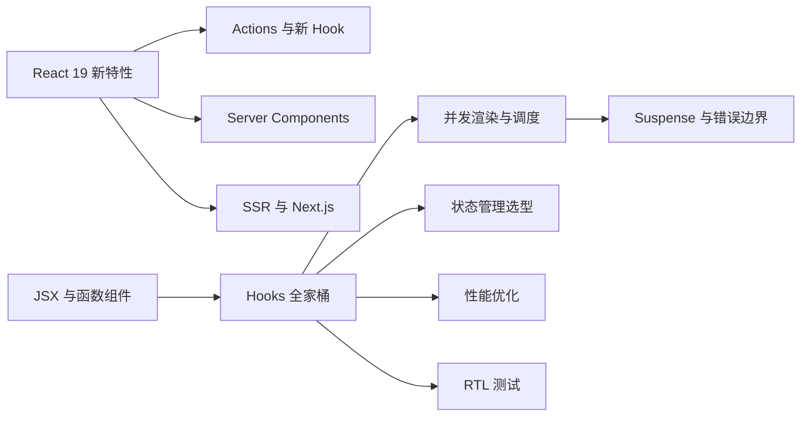
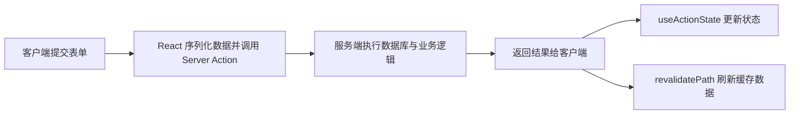

# React 19 与 Hooks 面试题库

> 面向前端面试场景的 React 19 专题题库，共 200 题（R19-001 ~ R19-200）。覆盖 React 19 新特性（Actions、useActionState、useOptimistic、use、ref 作为 prop、Document Metadata、Server Components/Server Actions）、JSX 本质、Hooks 全家桶、并发渲染、Suspense 与错误边界、状态管理选型、性能优化、SSR 与 Next.js、React Testing Library 测试，以及组件设计实战、Hooks 工程库、状态/表单工程、交互模式、性能实战、RSC 与 Next.js 进阶、测试质量与工程生态。所有代码均为现代函数组件 + Hooks 风格，基于 React 19 语法（不需要 import React）。

## 目录

- 第一章 React 19 新特性：R19-001 ~ R19-010
- 第二章 JSX 本质与函数组件：R19-011 ~ R19-015
- 第三章 Hooks 全家桶：R19-016 ~ R19-030
- 第四章 自定义 Hook 受控非受控与列表 key：R19-031 ~ R19-036
- 第五章 并发渲染 Suspense 与错误边界：R19-037 ~ R19-043
- 第六章 状态管理：R19-044 ~ R19-047
- 第七章 性能优化与 React Compiler：R19-048 ~ R19-052
- 第八章 SSR 与 Next.js：R19-053 ~ R19-056
- 第九章 React Testing Library 测试：R19-057 ~ R19-060
- 第十章 组件设计实战：R19-061 ~ R19-067
- 第十一章 Hooks 工程库：R19-068 ~ R19-075
- 第十二章 状态管理实战：R19-076 ~ R19-082
- 第十三章 表单工程：R19-083 ~ R19-088
- 第十四章 交互模式：R19-089 ~ R19-095
- 第十五章 性能实战：R19-096 ~ R19-101
- 第十六章 RSC 与 Next.js 实战：R19-102 ~ R19-107
- 第十七章 测试与质量：R19-108 ~ R19-112
- 第十八章 工程与生态：R19-113 ~ R19-130
- 第十九章 源码级简化实现：R19-131 ~ R19-137
- 第二十章 并发模式实战：R19-138 ~ R19-143
- 第二十一章 数据层工程：R19-144 ~ R19-150
- 第二十二章 大型项目架构：R19-151 ~ R19-157
- 第二十三章 状态库实现：R19-158 ~ R19-162
- 第二十四章 测试与质量工程：R19-163 ~ R19-167
- 第二十五章 性能专项深用：R19-168 ~ R19-172
- 第二十六章 React 与其他技术集成：R19-173 ~ R19-177
- 第二十七章 综合大题：R19-178 ~ R19-200

---

## 第一章 React 19 新特性（R19-001 ~ R19-010）

