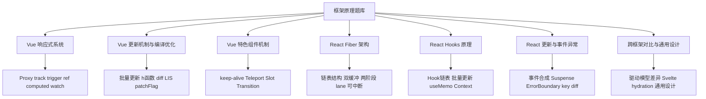

# 前端面试题库：框架原理

本章节聚焦 Vue 与 React 的**源码级原理**，每题给出"简化版可运行实现"代码（20~50 行级别，均注明"简化实现，帮助理解"），目标是不仅知道"是什么"，还能在白板上把核心机制写出来。覆盖 Vue 响应式系统（Proxy/track/trigger/effect、ref、computed、watch）、更新机制（批量更新、虚拟 DOM、diff 与最长递增子序列、编译优化）、Vue 特色机制（keep-alive、Teleport、Slot、Transition），React Fiber 架构（双缓冲、两阶段渲染、lane 优先级、可中断渲染）、Hooks 全家（useState/useEffect/useMemo/useRef/Context）、事件系统与 Suspense/ErrorBoundary，最后落到 Vue 与 React 的驱动模型差异、编译时 vs 运行时（Svelte）与框架通用设计。

## 目录

- 一、Vue 响应式系统（FRP-001 ~ FRP-008）
- 二、Vue 更新机制与编译优化（FRP-009 ~ FRP-016）
- 三、Vue 特色组件机制（FRP-017 ~ FRP-021）
- 四、React Fiber 架构（FRP-022 ~ FRP-027）
- 五、React Hooks 原理（FRP-028 ~ FRP-036）
- 六、React 更新、事件与异常处理（FRP-037 ~ FRP-045）
- 七、跨框架对比与通用设计（FRP-046 ~ FRP-050）
- 八、Vue 响应式源码再深入（FRP-051 ~ FRP-057）
- 九、Vue 编译器原理（FRP-058 ~ FRP-065）
- 十、Vue 运行时细节（FRP-066 ~ FRP-072）
- 十一、Vue Router 与 Pinia 原理（FRP-073 ~ FRP-078）
- 十二、React Hooks 深入（FRP-079 ~ FRP-086）
- 十三、React 渲染机制深入（FRP-087 ~ FRP-094）
- 十四、React 状态管理原理（FRP-095 ~ FRP-099）
- 十五、跨框架与编译原理（FRP-100 ~ FRP-106）
- 十六、框架工程层（FRP-107 ~ FRP-112）
- 十七、手写框架综合（FRP-113 ~ FRP-120）
- 十八、Vue3 响应式边界与陷阱（FRP-121 ~ FRP-127）
- 十九、Vue 组件模型深水区（FRP-128 ~ FRP-134）
- 二十、Vue3.3+ 新特性原理（FRP-135 ~ FRP-139）
- 二十一、React Server Components 深入（FRP-140 ~ FRP-147）
- 二十二、React 并发与调度深入（FRP-148 ~ FRP-154）
- 二十三、React 表单与模式原理（FRP-155 ~ FRP-160）
- 二十四、状态库与数据流原理对比（FRP-161 ~ FRP-166）
- 二十五、框架与浏览器协同（FRP-167 ~ FRP-172）
- 二十六、编译与转译层（FRP-173 ~ FRP-178）
- 二十七、手写进阶综合（FRP-179 ~ FRP-200）

## 一、Vue 响应式系统

