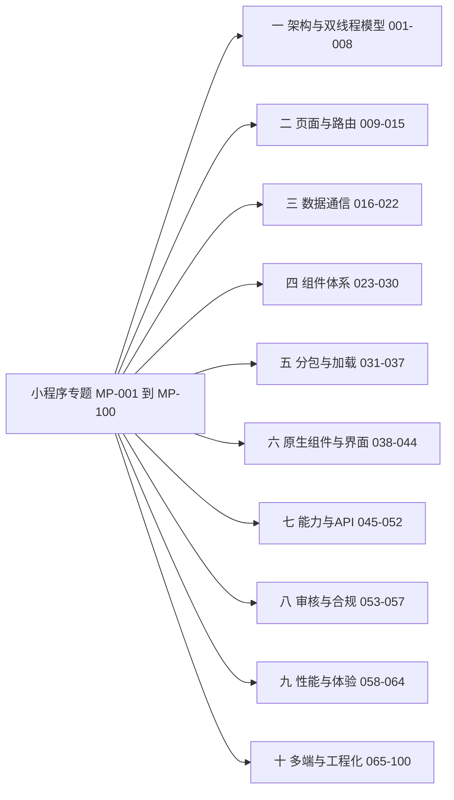

# 前端面试题库：小程序开发

## 简介

本专题聚焦**小程序开发**，以微信小程序为主干，兼顾支付宝/抖音（字节）小程序的多端差异。题目面向国内大厂高频考察点：双线程模型、setData 通信机制、页面栈与路由、组件体系、分包加载、原生组件同层渲染、登录与支付完整链路、审核合规、性能优化以及 Taro/uni-app 多端工程化。

- 编号规则：`MP-001 ~ MP-200`（001-100 基础篇，101-200 场景实战与综合设计篇）。
- 每题均带一个与题目严格对应的代码/配置块，可直接用于复习自测。
- 技术名词保留英文原文，答案以"要点式"呈现，便于面试口头复述。

## 目录

- 一、架构与双线程模型（MP-001 ~ MP-008）
- 二、页面与路由（MP-009 ~ MP-015）
- 三、数据通信（MP-016 ~ MP-022）
- 四、组件体系（MP-023 ~ MP-030）
- 五、分包与加载（MP-031 ~ MP-037）
- 六、原生组件与界面（MP-038 ~ MP-044）
- 七、能力与 API（MP-045 ~ MP-052）
- 八、审核与合规（MP-053 ~ MP-057）
- 九、性能与体验（MP-058 ~ MP-064）
- 十、多端与工程化（MP-065 ~ MP-100）
- 十一、业务场景实战（MP-101 ~ MP-110）
- 十二、跨小程序平台适配（MP-111 ~ MP-116）
- 十三、与 App/后端协作（MP-117 ~ MP-122）
- 十四、安全专题（MP-123 ~ MP-128）
- 十五、性能深水区（MP-129 ~ MP-135）
- 十六、测试与质量（MP-136 ~ MP-141）
- 十七、工程化深化（MP-142 ~ MP-147）
- 十八、云开发深入（MP-148 ~ MP-152）
- 十九、综合设计大题（MP-153 ~ MP-178）
- 二十、体系收束（MP-179 ~ MP-200）

---

## 一、架构与双线程模型（001-008）

