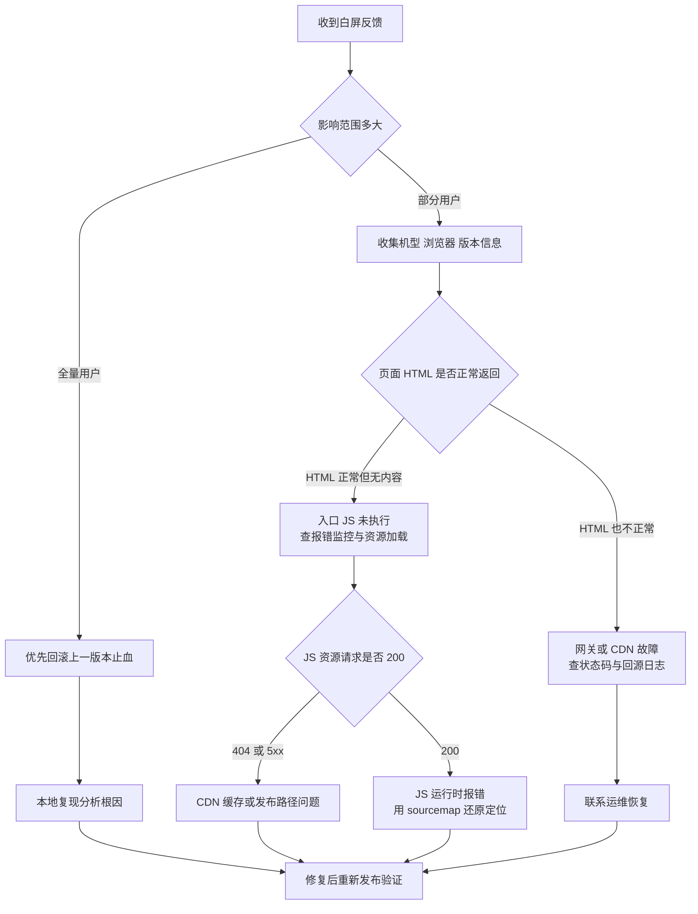

## SCN-001：线上页面突然大面积白屏，如何快速排查？
**答**：
- 先止血再查因：全量白屏优先回滚上一个版本；确认影响范围（全量还是部分用户、哪个版本、哪个入口）。
- 排查链路：入口 JS 资源是否加载失败（CDN、发布路径、缓存）→ JS 是否运行时报错（看监控、sourcemap 还原）→ 接口是否异常 → DOM 存在但不可见（样式或渲染逻辑问题）。
- 预防：接入白屏检测，onload 后检查根节点内容量，异常自动上报。

白屏排查决策树：



```javascript
// 白屏检测：onload 后采样根节点内容量，异常时上报现场
function checkWhiteScreen() {
  const root = document.querySelector('#app');
  const empty = !root || root.innerHTML.trim().length < 100;
  if (empty) {
    navigator.sendBeacon('/api/monitor', JSON.stringify({
      type: 'white-screen',
      url: location.href,
      version: window.APP_VERSION,
      // 上报 HTML 片段，方便还原当时现场
      html: document.documentElement.outerHTML.slice(0, 2000),
      time: Date.now(),
    }));
  }
}
window.addEventListener('load', () => setTimeout(checkWhiteScreen, 3000));
```
