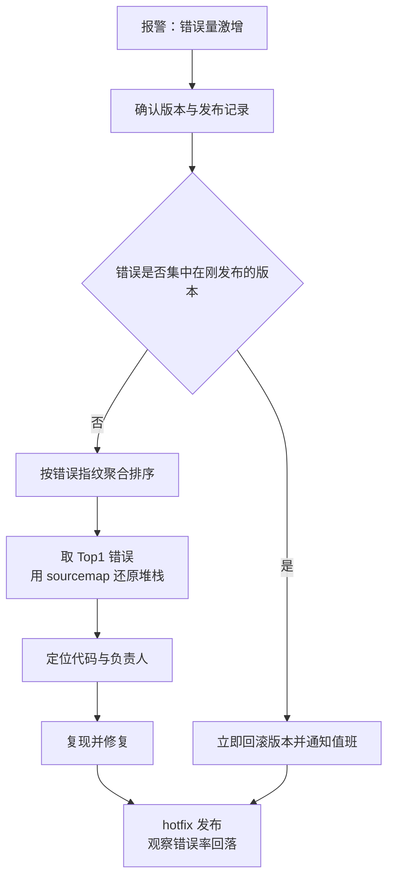

## SCN-002：发布后线上 JS 报错量激增，怎么排查？
**答**：
- 看报警面板确认三个维度：错误量环比、影响用户数、错误集中出现的版本号。
- 刚发布就激增 → 直接回滚并通知值班；未发布也激增 → 按错误指纹聚合，取 Top 错误用 sourcemap 还原堆栈。
- 定位到代码与负责人后修复，走 hotfix 发布，观察错误率回落再收尾；复盘时补齐该类错误的测试用例。



```javascript
// 错误指纹：同一错误聚合成一条，按发生量排序快速锁定主因
window.addEventListener('error', (e) => {
  const stack = (e.error && e.error.stack) || '';
  report({
    type: 'js-error',
    message: e.message,
    // 用 message + 堆栈首帧生成指纹，同一类错误指纹相同
    fingerprint: simpleHash(e.message + stack.split('\n')[1]),
    version: window.APP_VERSION, // 用于区分是否新版本引入
    url: location.href,
  });
}, true);
function simpleHash(str) {
  let h = 0;
  for (const ch of str) h = (h * 31 + ch.charCodeAt(0)) | 0;
  return h;
}
```
