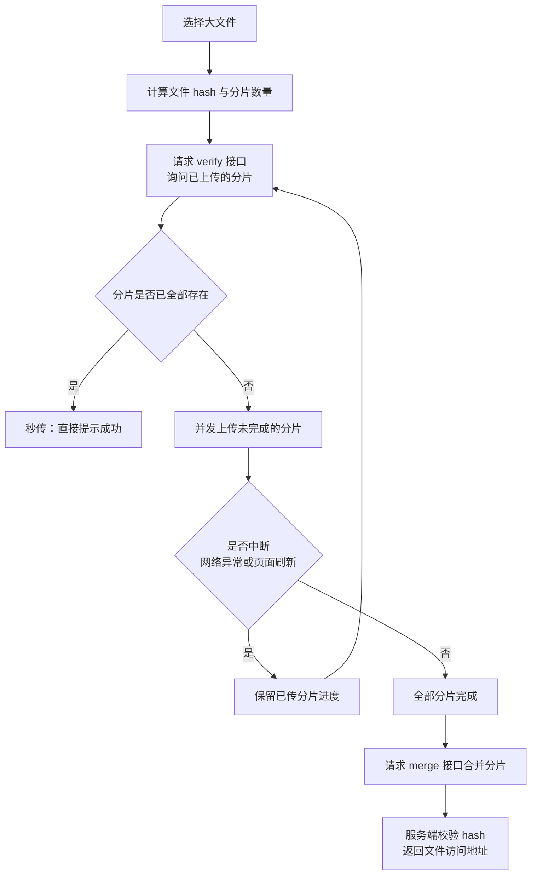

## SCN-012：场景设计：为网盘业务设计一套大文件分片上传与断点续传方案
**答**：
- 切片：`file.slice(start, end)` 按 5MB 一片，串行或小并发上传。
- 断点续传：上传前调 verify 接口，服务端返回已有分片索引，前端跳过即可续传。
- 合并：全部分片传完后调 merge，服务端按序合并并校验 hash；页面刷新后再进来，凭文件 hash 走同一套 verify 恢复进度。



```javascript
async function uploadBigFile(file) {
  const chunkSize = 5 * 1024 * 1024;
  const chunks = Math.ceil(file.size / chunkSize);
  // 1. verify：服务端返回文件 hash 与已上传分片，实现断点续传
  const { fileHash, uploaded } = await fetch('/api/upload/verify', {
    method: 'POST',
    headers: { 'Content-Type': 'application/json' },
    body: JSON.stringify({ name: file.name, size: file.size }),
  }).then((r) => r.json());

  // 2. 逐片上传，跳过已存在的分片
  for (let i = 0; i < chunks; i++) {
    if (uploaded.includes(i)) continue;
    const fd = new FormData();
    fd.append('chunk', file.slice(i * chunkSize, (i + 1) * chunkSize));
    fd.append('hash', `${fileHash}-${i}`); // 分片标识：文件 hash + 序号
    await fetch('/api/upload/chunk', { method: 'POST', body: fd });
    onProgress((i + 1) / chunks);
  }

  // 3. 通知服务端合并
  await fetch('/api/upload/merge', {
    method: 'POST',
    headers: { 'Content-Type': 'application/json' },
    body: JSON.stringify({ fileHash, chunks }),
  });
}
```
