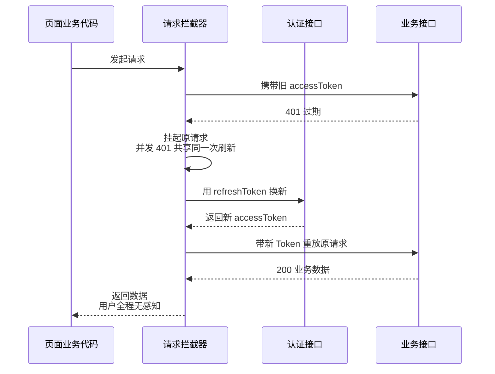

## SCN-018：accessToken 过期后如何做到用户无感刷新？
**答**：
- 双 Token：accessToken 短期有效随业务请求携带，refreshToken 长期有效仅用于换新。
- 拦截器捕获 401：用 refreshToken 换新 Token，成功后重放原请求；refreshToken 也失效才踢回登录页。
- 并发 401 只触发一次刷新：用"刷新进行中"的 Promise 复用，所有挂起请求等同一个结果，完成后统一带新 Token 重放。

Token 无感刷新时序：



```javascript
let refreshing = null; // 复用同一次刷新，并发 401 只打一次认证接口
async function request(config) {
  try {
    return await axios(config);
  } catch (err) {
    if (err.response?.status !== 401) throw err;
    refreshing ??= fetch('/api/auth/refresh', {
      method: 'POST',
      body: localStorage.getItem('refreshToken'),
    })
      .then((r) => r.json())
      .then(({ accessToken }) => {
        localStorage.setItem('accessToken', accessToken);
        return accessToken;
      })
      .finally(() => { refreshing = null; }); // 刷新结束清空，下次过期重新刷新
    const token = await refreshing;           // 并发 401 共享同一个 Promise
    config.headers.Authorization = `Bearer ${token}`;
    return axios(config);                     // 重放原请求
  }
}
```
