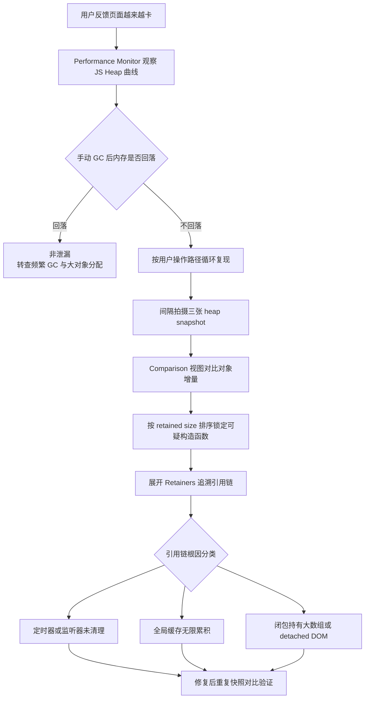

## SCN-053：用户反馈页面用着用着越来越卡，怀疑内存泄漏，如何定位并证明？
**答**：
- 先证明再定位：Performance Monitor 看 JS Heap 曲线，手动 GC 后仍不回落才判泄漏；能回落说明只是分配量大，转查算法与大对象。
- 复现路径固定后间隔拍 3 张 heap snapshot，用 Comparison 视图看增量对象的 constructor 与 retained size，顺 Retainers 追引用链找到根因。
- 常见根因三类：定时器/事件监听未清理、全局缓存无限累积、闭包或 detached DOM 持有大数组；修复后重复快照对比闭环验证。

内存泄漏排查步骤：



```javascript
// 自动化泄漏探测：循环执行可疑操作后采样 heap，判断是否单调上涨
async function detectLeak(action, rounds = 20) {
  const samples = [];
  for (let i = 0; i < rounds; i++) {
    await action();
    if (window.gc) window.gc();   // Chrome 需带 --js-flags=--expose-gc 启动
    samples.push(performance.memory.usedJSHeapSize);
    await new Promise((r) => setTimeout(r, 100));
  }
  // 取后半段算增长斜率：每轮平均增长超过 10KB 视为疑似泄漏
  const half = samples.slice(rounds / 2);
  const slope = (half[half.length - 1] - half[0]) / half.length;
  console.log('heap samples(KB):', samples.map((n) => Math.round(n / 1024)));
  console.log(slope > 10 * 1024 ? '疑似内存泄漏，请抓快照分析' : '未见明显泄漏');
}
```
