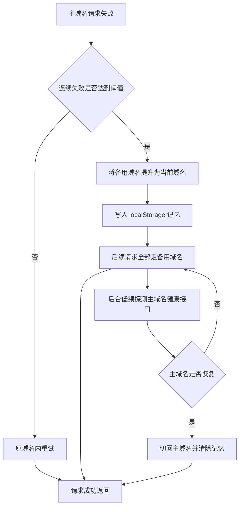

## SCN-078：核心接口所在机房故障，如何让前端自动切换备用域名恢复可用？
**答**：
- 机制：请求失败（网络错误/超时/5xx）连续达阈值后把备用域名提升为当前域名，localStorage 记忆切换结果，用户直开页面也不重复踩坑。
- 恢复：后台低频探测主域名（HEAD /healthz），恢复后自动切回并清除记忆。
- 切换动作本身要上报监控，形成"切换率"指标——切换率突增本身就是机房故障的最早报警。



```javascript
// 备用域名切换：失败计数 -> 切换 -> 记忆 -> 恢复探测
const DOMAINS = ['https://api.example.com', 'https://api-bak.example.com'];

const currentDomain = () => localStorage.getItem('api-domain') ?? DOMAINS[0];

async function request(path, options, failCount = { n: 0 }) {
  try {
    const res = await fetch(currentDomain() + path,
      { ...options, signal: AbortSignal.timeout(5000) });
    if (!res.ok && ++failCount.n >= 3) switchDomain();   // 连续 3 次失败切换
    else failCount.n = 0;
    return res;
  } catch (err) {
    if (++failCount.n >= 3) {
      switchDomain();
      return request(path, options, failCount);          // 立即用新域名重放本次请求
    }
    throw err;
  }
}

function switchDomain() {
  const cur = currentDomain();
  const next = DOMAINS.find((d) => d !== cur);
  localStorage.setItem('api-domain', next);              // 记忆切换，直开页面也生效
  report({ type: 'domain-switch', from: cur, to: next });
  probePrimary(cur);
}

function probePrimary(primary) {
  const timer = setInterval(async () => {
    try {
      await fetch(`${primary}/healthz`, { mode: 'no-cors', signal: AbortSignal.timeout(2000) });
      localStorage.removeItem('api-domain');             // 恢复后切回主域名
      clearInterval(timer);
    } catch { /* 继续探测 */ }
  }, 60000);
}
```
