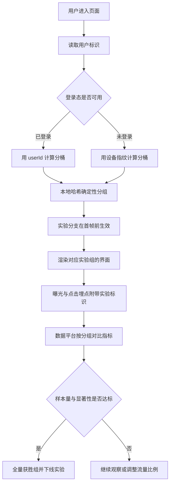

## SCN-116：产品要做新首页 A/B 实验，前端如何接入并保证数据可信？
**答**：
- 可信四要素：分流稳定（用户维度确定性哈希分桶，同一用户永远同组，登录前后身份归一）；防闪烁（实验分支在首帧前生效，不能先渲染默认样式再替换）；埋点带实验标识（曝光/点击都附 experiment+variant，统计才能分组对比）；防污染（剔除爬虫与内部员工，样本量与显著性达标才下结论）。

A/B 实验接入流程：



```javascript
// A/B 接入：首帧前确定性分流 + 埋点标识 + 登录身份归一
function getVariant(userId, experiment, ratios = [0.5, 0.5]) {
  let h = 0;
  for (const c of `${experiment}:${userId}`) h = (h * 31 + c.charCodeAt(0)) >>> 0;
  const slot = (h % 10000) / 10000;         // 同一用户永远得到同一结果
  let acc = 0;
  for (let i = 0; i < ratios.length; i++) {
    acc += ratios[i];
    if (slot < acc) return i;
  }
  return ratios.length - 1;
}

// 首帧前执行：head 内联脚本或 SSR 注入，渲染前确定分支，不闪默认样式
const variant = getVariant(userId || getDeviceId(), 'home-redesign-v2');
document.documentElement.dataset.variant = variant;
// CSS 按分支渲染：html[data-variant="1"] .hero { background: url(new-banner.webp); }

// 埋点统一附带实验上下文，供数据平台分组对比
function trackWithExperiment(event, payload) {
  track(event, { ...payload, exp: { key: 'home-redesign-v2', variant } });
}

// 登录后身份归一：匿名分桶与登录分桶做映射上报，保证漏斗连续
onLogin((uid) => trackWithExperiment('ab-identity', { anonId: getDeviceId(), userId: uid }));
```
