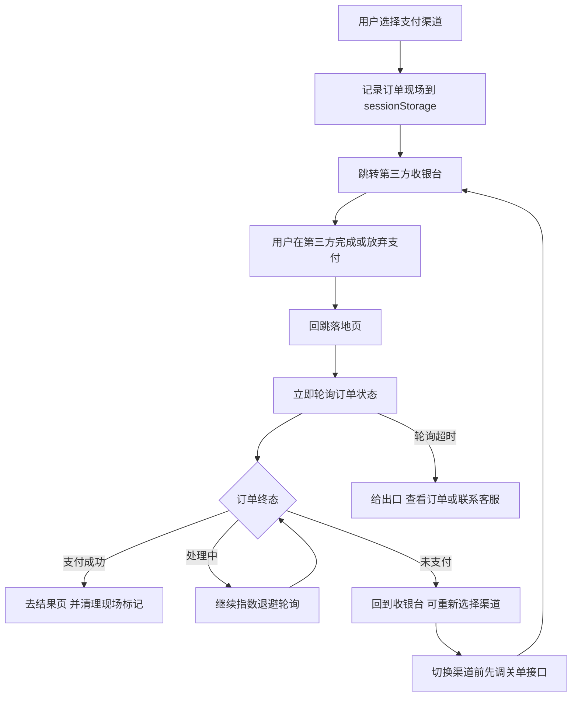

## SCN-132：收银台支持微信、支付宝、银行卡多渠道，跳转第三方后回跳如何保证不丢单？
**答**：
- 跳转前把 `orderNo + channel + 发起时间` 写入 sessionStorage，回跳落地页先恢复现场再谈其他。
- 回跳后状态未知：立即轮询订单状态，而不是相信 URL 参数；成功去结果页，处理中继续轮询，失败才允许重新支付（换渠道前先调关单接口防止两个渠道都付成功）。
- 兜底：轮询超时给"支付遇到问题？查看订单/联系客服"出口，并把"我已支付"按钮做成强校验入口。
- 渠道切换要防并发：A 渠道未关单就切 B，是丢单与双扣的主要来源。

支付回跳状态机：



```javascript
// 收银台回跳恢复：现场标记 + 轮询裁决 + 换渠道先关单
const PAY_FLAG = 'pay_ctx';
export function startPay(orderNo, channel) {
  sessionStorage.setItem(PAY_FLAG, JSON.stringify({ orderNo, channel, ts: Date.now() }));
  location.href = api.getPayUrl(orderNo, channel);      // 微信/支付宝跳第三方
}

export async function resumeAfterPay() {
  const ctx = JSON.parse(sessionStorage.getItem(PAY_FLAG) ?? 'null');
  if (!ctx) return renderCashierPage();                 // 正常进收银台
  // 回跳后不信 URL，轮询订单状态裁决
  const status = await pollOrder(ctx.orderNo, { timeout: 15_000, interval: 1_000 });
  if (status === 'PAID') { sessionStorage.removeItem(PAY_FLAG); location.href = '/pay/success'; }
  else if (status === 'UNPAID') renderCashierPage({ resumeOrder: ctx.orderNo });
}

export async function switchChannel(orderNo, nextChannel) {
  await api.closePay(orderNo);                          // 关掉旧渠道支付单，防双扣
  startPay(orderNo, nextChannel);
}

async function pollOrder(orderNo, { timeout, interval }) {
  const deadline = Date.now() + timeout;
  while (Date.now() < deadline) {
    const { status } = await api.queryOrderStatus(orderNo);
    if (status !== 'PAYING') return status;             // PAID / UNPAID / CLOSED
    await new Promise(r => setTimeout(r, interval));
  }
  return 'TIMEOUT';                                     // 超时给查看订单/客服出口
}
```
