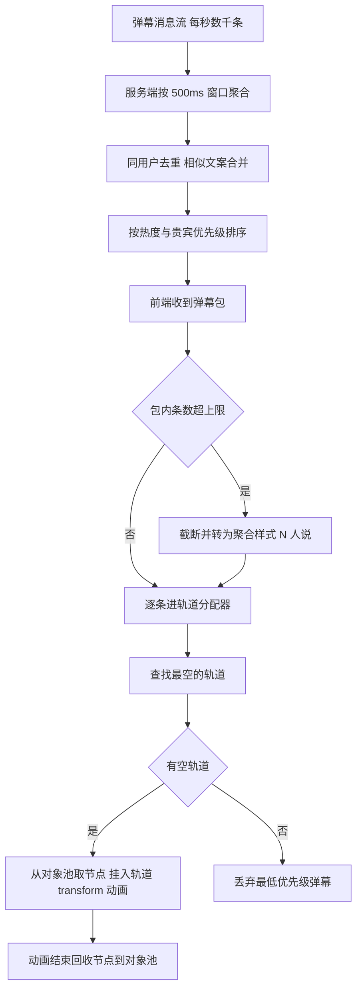

## SCN-158：直播弹幕每秒几千条，全量渲染必卡，前端如何渲染撑住"弹幕风暴"？
**答**：
- 源头聚合：服务端（或网关）按 500ms 窗口聚合下发（同用户去重、相似内容合并、只送高热弹幕 + 计数），把几千条/秒压到几十条/包。
- 前端双层过滤：单包超量时按优先级（贵宾/首条/高赞）截断，普通弹幕转为"N 人说：xxx"的聚合样式。
- 渲染走轨道模型：固定 N 条轨道，每条轨道记录"最后一条弹幕的出轨时间"，新弹幕找最空的轨道，轨道满则丢弃低优先级弹幕。
- 每条弹幕用 transform 合成层动画（离场自动回收 DOM，对象池复用），rAF 单点驱动，不依赖 CSS animation 泛滥。

弹幕渲染链路：



```javascript
// 弹幕风暴渲染：轨道分配 + 对象池 + 单 rAF 驱动
class DanmakuEngine {
  constructor(el, { lanes = 8, maxPerPack = 30 } = {}) {
    this.lanes = Array.from({ length: lanes }, () => ({ lastEnd: 0, el: null }));
    this.pool = [];                                    // 对象池：DOM 节点复用
    this.queue = [];
    this.maxPerPack = maxPerPack;
    this.rafLoop();
  }
  pushPack(pack) {
    // 包内超量截断：贵宾与高赞优先
    const list = [...pack.items].sort((a, b) => (b.vip - a.vip) || (b.likes - a.likes));
    if (list.length > this.maxPerPack) {
      this.queue.push(makeAggregated(list.slice(this.maxPerPack))); // 剩余聚合为 N 人说
      list.length = this.maxPerPack;
    }
    this.queue.push(...list);
  }
  allocEl() { return this.pool.pop() ?? document.createElement('span'); }
  spawn(item) {
    // 选"最空"的轨道：预估到达时间最早的
    const lane = this.lanes.reduce((a, b) => a.lastEnd <= b.lastEnd ? a : b);
    const now = performance.now();
    if (lane.lastEnd > now) return false;              // 全满则丢弃（低优先级已被截断）
    const el = this.allocEl();
    el.textContent = item.text;
    el.className = `danmaku p${item.priority}`;
    lane.el ??= this.createLaneHolder();
    lane.el.appendChild(el);
    const duration = 8000;
    lane.lastEnd = now + duration * 0.15;              // 同轨间隔：出场前 15% 时间可接新条
    el.animate([{ transform: 'translateX(100vw)' }, { transform: `translateX(-${el.scrollWidth}px)` }],
      { duration, easing: 'linear' }).onfinish = () => { el.remove(); this.pool.push(el); };
    return true;
  }
  rafLoop = () => {
    // 每帧最多 spawn 2 条，防止一包瞬间全部入轨
    for (let i = 0; i < 2 && this.queue.length; i++) {
      if (!this.spawn(this.queue.shift())) break;
    }
    requestAnimationFrame(this.rafLoop);
  };
}
```
