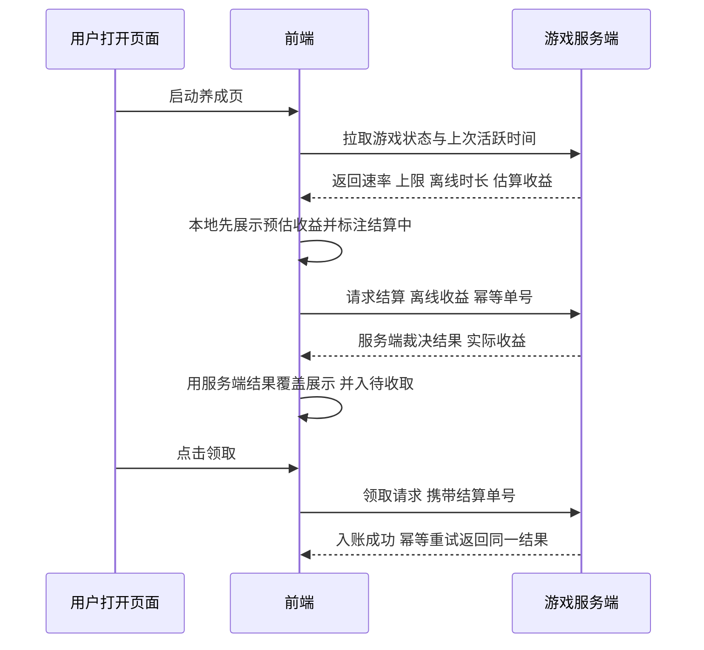

## SCN-167：养成类游戏（种树/养鸡）要计算用户离线期间的收益，回归时结算，怎么设计与防刷？
**答**：
- 收益模型：`离线收益 = 速率 × min(离线时长, 上限)`，离线起点 = 服务端记录的上次活跃时间，前端本地时间不可信。
- 回归流程：客户端展示"您离开 X 小时，收获 N"用本地估算做即时反馈（标注"结算中"），随后以服务端结算结果为准刷新，两端不一致以服务端为准并解释。
- 防刷核心在服务端：速率变更、收益上限、活跃心跳都在服务端记账，前端估算仅供展示；改本地时间无法多得收益。
- 结算与领取分离：结算进"待收取"，用户点击收取才入账（提升一次交互），收取请求幂等（结算单号）。

回归结算时序：



```javascript
// 离线收益：前端估算展示 + 服务端裁决 + 幂等领取
export async function settleOfflineEarnings() {
  // 服务端状态里带上次活跃时间与速率，前端只展示估算
  const state = await api.getFarmState();              // { ratePerHour, lastActiveAt, capHours }
  const offlineHours = Math.min(
    (state.serverNow - state.lastActiveAt) / 3600_000,
    state.capHours                                     // 收益上限：最多累计 12h
  );
  const estimate = Math.floor(state.ratePerHour * offlineHours);

  showOfflineModal({ hours: offlineHours, estimate, pending: true }); // 标注"结算中"

  // 结算：幂等单号防重放，服务端按自己记录的活跃时间裁决
  const settleId = `settle-${state.userId}-${state.lastActiveAt}`;
  const result = await api.settleEarnings({ settleId })
    .catch(() => ({ amount: estimate, authoritative: false }));
  showOfflineModal({ hours: offlineHours, estimate: result.amount, pending: false });

  return result;                                       // { amount, pendingReceiveId }
}

// 领取：幂等，重复点击/重试安全
export async function receiveEarnings(pendingReceiveId) {
  return api.receive({ pendingReceiveId });            // 服务端按单号幂等，重试无副作用
}

```

## 二十九、工程效能场景
