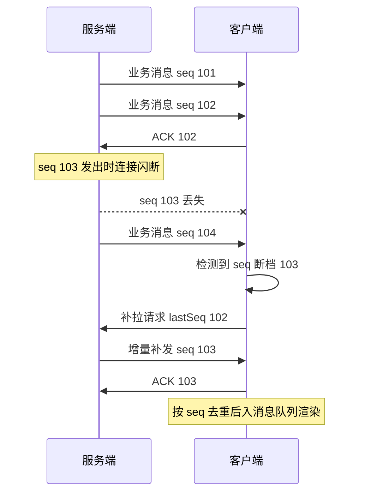

## SCN-184：WebSocket 心跳一直正常，但业务消息偶发丢失，如何在传输层之上做可靠性设计？
**答**：
- 心跳只证明"连接活着"，不保证"消息必达"：服务端发出消息时客户端可能正在重连的间隙、或消息在网络中丢弃，TCP 断连重连期间的消息天然丢失。
- 可靠层核心是"序号 + 确认 + 补拉"：每条业务消息带自增 seq，客户端检测到 seq 断档，携带 lastSeq 请求增量补发；服务端保留每个连接最近 N 分钟的消息 ring buffer。
- 关键业务消息（交易通知）走"客户端确认"：服务端未收到 ACK 定时重投；客户端对消息幂等消费（seq 去重）。
- 重连后的第一件事永远是"带着 lastSeq 拉快照 + 增量"，而不是干等推送。

消息可靠层时序：



```javascript
// WebSocket 可靠层：seq 连续性检测 + ACK + 断线补拉
export class ReliableSocket {
  lastSeq = 0;
  buffer = new Map();                                  // 乱序暂存
  constructor(url, handlers) {
    this.handlers = handlers;
    this.connect(url);
  }
  connect(url) {
    this.ws = new WebSocket(url);
    this.ws.onopen = () => this.resync();              // 每次连接先补拉，防缺口
    this.ws.onmessage = e => this.onMessage(JSON.parse(e.data));
    this.ws.onclose = () => setTimeout(() => this.connect(url), this.backoff());
  }
  onMessage(msg) {
    if (msg.seq > this.lastSeq + 1) {                  // 检测到断档：103 丢了
      this.requestResync(this.lastSeq);
    }
    if (msg.seq <= this.lastSeq || this.buffer.has(msg.seq)) return; // 幂等：seq 去重
    if (msg.seq === this.lastSeq + 1) {
      this.lastSeq = msg.seq;
      this.handlers.message(msg);
      // 放行暂存区里连续的后续消息
      while (this.buffer.has(this.lastSeq + 1)) {
        this.lastSeq++;
        this.handlers.message(this.buffer.get(this.lastSeq));
        this.buffer.delete(this.lastSeq);
      }
      this.ack(msg.seq);                               // 关键消息确认
    } else {
      this.buffer.set(msg.seq, msg);                   // 乱序先暂存
    }
  }
  ack(seq) { this.send({ type: 'ACK', seq }); }
  requestResync(lastSeq) { this.send({ type: 'RESYNC', lastSeq }); }
  async resync() {
    // 重连后：服务端按 lastSeq 从 ring buffer 补发增量
    this.send({ type: 'RESYNC', lastSeq: this.lastSeq });
  }
  send(data) { this.ws.readyState === 1 && this.ws.send(JSON.stringify(data)); }
  backoff() { return Math.min(30_000, (this._b = (this._b ?? 500) * 2)); }
}

```
