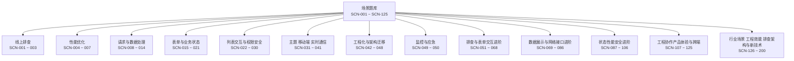

# 前端面试题库：场景考察 200 题

本文件收录"真实工作场景"考察题：给出业务或线上问题的情境，按"处理思路 + 可落地代码"组织答案。SCN-001 ~ 050 覆盖线上排查、性能优化、请求治理、状态与表单、安全、移动端、实时通信、监控与工程化协作十二类场景；SCN-051 ~ 125 在此基础上扩充排查进阶、表单交互、数据展示、网络接口、状态管理、性能与安全进阶、工程协作、产品体验与跨端共十大方向；SCN-126 ~ 200 再扩充十个新维度——电商交易、内容社区、办公 B 端、地图位置、音视频、游戏化互动、工程效能、深度排查、架构落地与新技术融合，与 01~09 专题的概念题互补，专练"拿到问题怎么落地"。

## 目录

### 一、线上问题排查（SCN-001 ~ SCN-003）
### 二、性能优化实战（SCN-004 ~ SCN-007）
### 三、请求与数据处理（SCN-008 ~ SCN-014）
### 四、表单与交互状态（SCN-015 ~ SCN-017）
### 五、登录态与业务状态（SCN-018 ~ SCN-021）
### 六、复杂列表与交互（SCN-022 ~ SCN-025）
### 七、权限与安全（SCN-026 ~ SCN-030）
### 八、主题与国际化（SCN-031 ~ SCN-032）
### 九、移动端与微信 H5（SCN-033 ~ SCN-038）
### 十、实时通信（SCN-039 ~ SCN-041）
### 十一、工程化与架构迁移（SCN-042 ~ SCN-048）
### 十二、监控与应急（SCN-049 ~ SCN-050）
### 十三、线上问题排查进阶（SCN-051 ~ SCN-058）
### 十四、表单与交互进阶（SCN-059 ~ SCN-068）
### 十五、数据展示进阶（SCN-069 ~ SCN-076）
### 十六、网络与接口进阶（SCN-077 ~ SCN-086）
### 十七、状态管理进阶（SCN-087 ~ SCN-092）
### 十八、性能场景进阶（SCN-093 ~ SCN-100）
### 十九、安全场景进阶（SCN-101 ~ SCN-106）
### 二十、工程协作（SCN-107 ~ SCN-114）
### 二十一、产品与体验（SCN-115 ~ SCN-120）
### 二十二、移动端与跨端（SCN-121 ~ SCN-125）
### 二十三、电商与交易场景（SCN-126 ~ SCN-134）
### 二十四、内容与社区场景（SCN-135 ~ SCN-141）
### 二十五、办公与 B 端场景（SCN-142 ~ SCN-149）
### 二十六、地图与位置场景（SCN-150 ~ SCN-155）
### 二十七、音视频场景（SCN-156 ~ SCN-162）
### 二十八、游戏化与互动（SCN-163 ~ SCN-167）
### 二十九、工程效能场景（SCN-168 ~ SCN-176）
### 三十、深度排查场景（SCN-177 ~ SCN-185）
### 三十一、架构落地场景（SCN-186 ~ SCN-193）
### 三十二、新技术融合场景（SCN-194 ~ SCN-200）

## 一、线上问题排查

