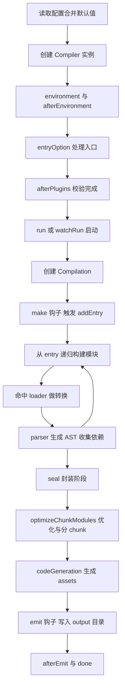

## BLD-002：webpack 构建流程全阶段是怎样的？各阶段有哪些关键 hooks？
**答**：
- 初始化阶段：读取配置合并默认值，创建 Compiler，调用 environment / afterEnvironment / entryOption / afterPlugins / beforeRun。
- 编译阶段：run → new Compilation → make 触发 addEntry → 从 entry 递归 buildModule：命中 loader 转换 → parser 生成 AST → 收集依赖 → 递归处理依赖形成模块图。
- 封装阶段：seal，进入优化（optimizeChunkModules、ModuleConcatenationPlugin）→ 分 chunk → 生成 assets（codeGeneration）。
- 产出阶段：emit 钩子把 assets 写入 output.path（这里最后修改产物的机会）→ afterEmit → done。
- 面试要求能顺着这条链报出 hooks 名并说明何时用哪个（改产物用 emit，改模块图用 seal 之前的 compilation 钩子）。



```javascript
// webpack.config.js：在关键阶段埋点的完整插件
class StageHooksPlugin {
  apply(compiler) {
    compiler.hooks.beforeRun.tap('Stage', () => console.log('[1] beforeRun'));
    compiler.hooks.thisCompilation.tap('Stage', (compilation) => {
      compilation.hooks.addEntry.tap('Stage', () => console.log('[2] addEntry'));
      compilation.hooks.finishModules.tap('Stage', (modules) => {
        console.log('[3] finishModules 模块图构建完成 共', modules.size);
      });
      compilation.hooks.seal.tap('Stage', () => console.log('[4] seal'));
      compilation.hooks.processAssets.tap(
        { name: 'Stage', stage: compilation.constructor.PROCESS_ASSETS_STAGE_ADDITIONAL },
        (assets) => console.log('[5] processAssets 产物有', Object.keys(assets)),
      );
    });
    compiler.hooks.emit.tap('Stage', () => console.log('[6] emit'));
    compiler.hooks.done.tap('Stage', (stats) => console.log('[7] done', stats.endTime - stats.startTime, 'ms'));
  }
}

module.exports = { plugins: [new StageHooksPlugin()] };
```
