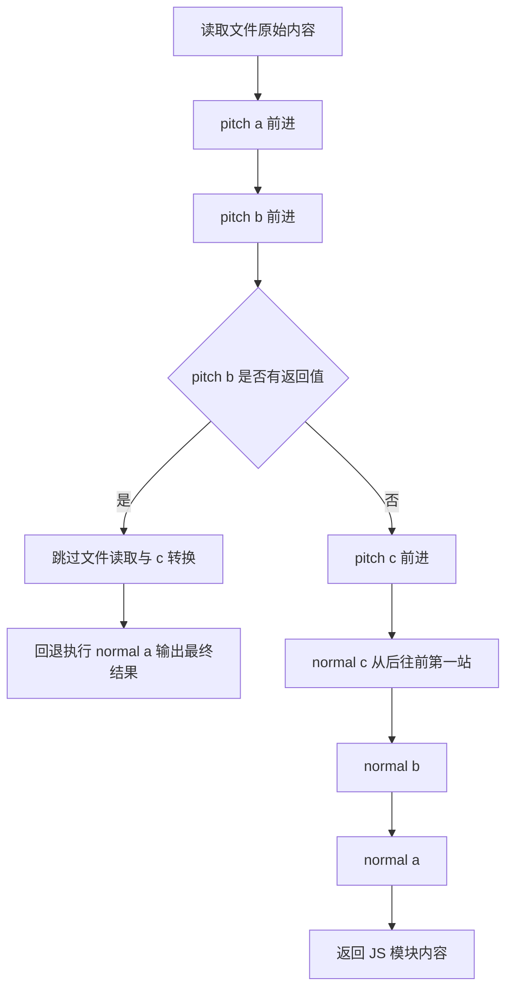

## BLD-017：loader 的输入输出与 pitch 阶段是怎样的？画出 pitching 流程。
**答**：
- normal 阶段：配置 `use: ['a', 'b', 'c']`，文件内容先过 c 再过 b 再过 a（从后往前），每个 loader 返回值作为下一个的输入；最后必须返回 JS（或可被处理的字符串/Buffer）。
- pitch 阶段：从前往后先执行 a.pitch / b.pitch / c.pitch；若某个 pitch 有返回值，则跳过后续 loader 和文件读取，直接回退执行"该 pitch 之前的 normal loader"。
- 经典应用：style-loader 的 pitch 里把 css 结果转成注入 script，直接返回，从而不再走文件读取后的 normal 链。
- pitch 还可拿到 remainingRequest / previousRequest / data（pitch 与 normal 共享的 data 对象）。



```javascript
// a-loader.js：演示 pitch 返回值中断链路
module.exports = function (content) {
  console.log('normal a 收到', content.length, '字节');
  return content;
};
module.exports.pitch = function (remainingRequest, previousRequest, data) {
  // data 会在 pitch 与 normal 之间共享
  data.fromPitch = true;
  // 返回值则跳过 b/c 与文件读取 直接进入 a 的 normal
  // return `module.exports = 'short-circuit from pitch'`;
};

// 配置 use: ['./a-loader', './b-loader', './c-loader']
// 执行顺序：a.pitch -> b.pitch -> c.pitch -> [读文件] -> c -> b -> a
// 若 b.pitch 返回了值：a.pitch -> b.pitch -> a（normal）
```
