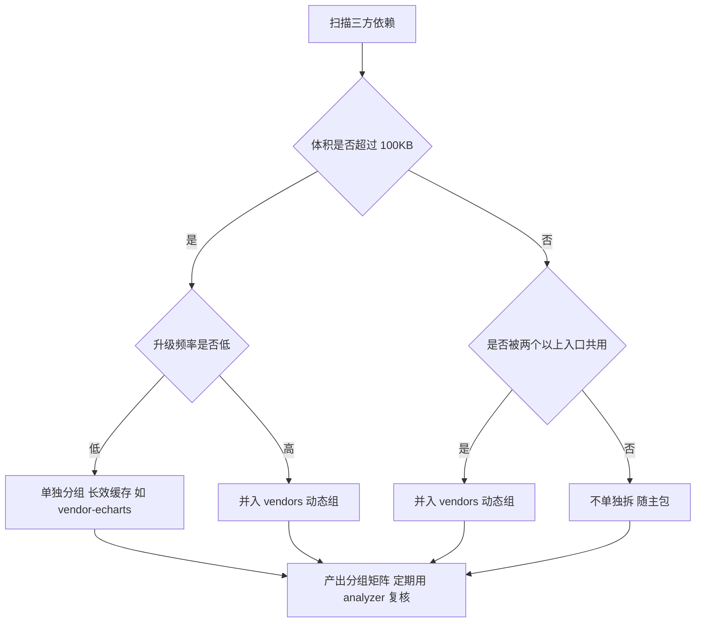

## BLD-037：给出一个三方库 vendor 分包矩阵的实际策略。
**答**：
- 分类维度：稳定性（是否常升级）、体积、使用频率、是否含大依赖（如 moment 的 locale）。
- 矩阵：稳定大型库（react/vue/echarts）单独成组享长效缓存；中型工具（lodash/dayjs）合并 vendors；高频小工具不单独拆（请求开销 > 收益）；多版本共存的库按版本分组或 resolve.dedupe 收敛。
- 迁移友好：name 用固定字符串，别用 [hash]，否则分包意义尽失。
- 用 bundle analyzer 的 treemap 验证每个分组的实际占比，定期 review。



```javascript
// webpack.config.js：分包矩阵落地
module.exports = {
  optimization: {
    splitChunks: {
      chunks: 'all',
      cacheGroups: {
        // 稳定大型库 独立缓存
        'vendor-vue': {
          test: /[\\/]node_modules[\\/](vue|vue-router|pinia)[\\/]/,
          name: 'vendor-vue', priority: 50,
        },
        'vendor-echarts': {
          test: /[\\/]node_modules[\\/](echarts|zrender)[\\/]/,
          name: 'vendor-echarts', priority: 50, chunks: 'async',
        },
        'vendor-editor': {
          test: /[\\/]node_modules[\\/](monaco-editor|@monaco-editor)[\\/]/,
          name: 'vendor-editor', priority: 50, chunks: 'async',
        },
        // 中型工具合并
        vendors: { test: /[\\/]node_modules[\\/]/, name: 'vendors', priority: 10 },
        // 业务公共
        commons: { test: /[\\/]src[\\/]common/, name: 'commons', minChunks: 2, priority: 20 },
      },
    },
  },
};
```
