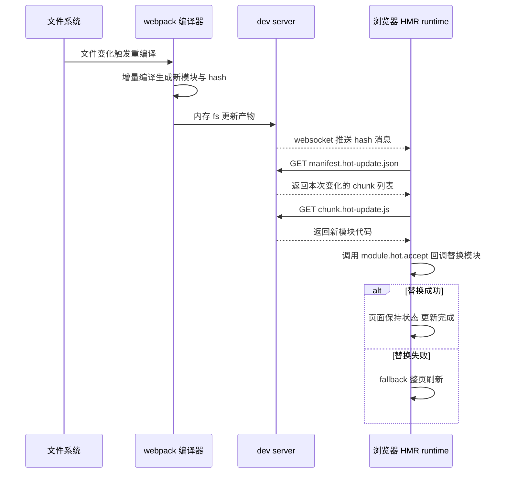

## BLD-039：HMR 的完整流程是怎样的？画出时序图。
**答**：
- 第一步：文件变化，webpack 的 watcher 触发重编译，webpack-dev-middleware 内存 fs 更新。
- 第二步：服务端通过 websocket 推送消息（先 ok/hash，带本次编译 hash）。
- 第三步：客户端 HMR runtime 收到新 hash 后请求两个文件：manifest（.hot-update.json，记录哪些 chunk 变了）和 update（.hot-update.js，新模块代码）。
- 第四步：runtime 调 module.hot.accept 注册的回调，用新模块替换旧模块；替换成功则热更新，失败回退整页刷新。
- 面试高频追问：hash 的作用是匹配版本（请求的 update 文件名带 hash，避免串版本）；accept 的粒度是模块，谁 accept 谁负责替换。



```javascript
// webpack.config.js：开启 HMR 的最小生产级配置
module.exports = {
  mode: 'development',
  devServer: {
    hot: true,               // 注入 HMR runtime 与 websocket 服务
    liveReload: false,       // 关闭整页刷新通道 逼出热更新问题
    static: { directory: 'public' },
  },
  devtool: 'eval-cheap-module-source-map', // HMR 场景最快的可读 sourcemap
};
```
