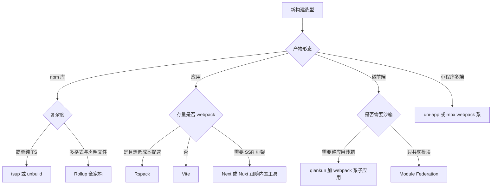

## BLD-087：构建工具选型的决策树是什么？（应用 / 库 / 微前端 / 多端）
**答**：
- 应用（SPA/中后台）：默认 Vite（新项目）或 Rspack（大 webpack 项目提速）；需要 Next/Nuxt 全栈框架就跟框架走（Turbopack/Rollup 内置）。
- 库/组件库：Rollup（产物质量最优）或 tsup/unbuild（esbuild 封装，够用且零配置）；纯 TS 工具库 tsup 最省心，复杂产物矩阵 Rollup。
- 微前端：host 用任意工具 + MF；qiankun 场景子应用须能输出 UMD（webpack/rspack 天然支持，Vite 需插件且有限）。
- 多端（小程序/Node/浏览器同构）：看目标端 loader 生态成熟度，小程序构建仍以 webpack 系（uni-app/mpx）为主。



```javascript
// text 代码块：决策速查表
// 场景                 首选                 备选
// React/Vue SPA        Vite                 Rspack 或 webpack5
// Next 全栈            Turbopack 内置        -
// 组件库多格式          Rollup               tsup + dts
// Node CLI/工具库      tsup                 esbuild 直调
// 大型老 webpack 应用   Rspack 渐进迁移       webpack5 缓存调优
// 微前端 host+remote   Module Federation    qiankun
```
