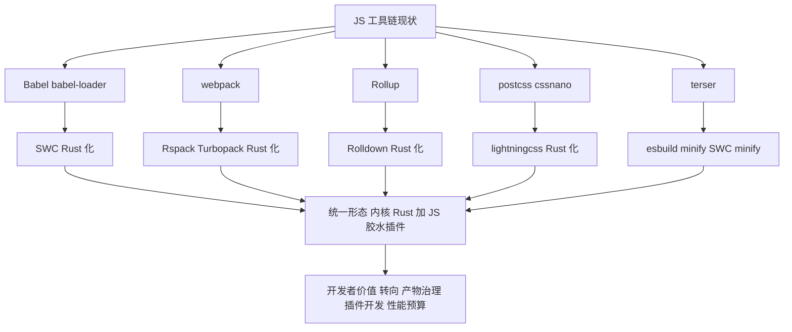

## BLD-099：前端构建的未来趋势是什么？bundleless、Rust 化工具链全景怎么看？
**答**：
- bundleless dev 成主流：dev 不打包（Vite 开创），Turbopack/Rspack 把"打包也增量到函数级"——本质都是把编译开销摊到按需与增量。
- Rust 化全景：SWC（babel 位）、Rspack（webpack 位）、lightningcss（postcss 位）、Rolldown（Rust 版 Rollup，Vite 的未来底座）、Turbopack（next 位）——JS 工具层逐步下沉为"内核 Rust + 胶水 JS 插件"。
- 概念收敛：bundler/framework/monorepo 工具（Vite+Rolldown、Next+Turbopack、Rspack+Rsbuild+NX）彼此渗透，"选构建器"逐渐变成"选框架全家桶"。
- 对工程师的要求变化：从"会写 webpack 配置"转向"会读产物、会定预算、会写插件（JS 层）与理解底层管线"。

