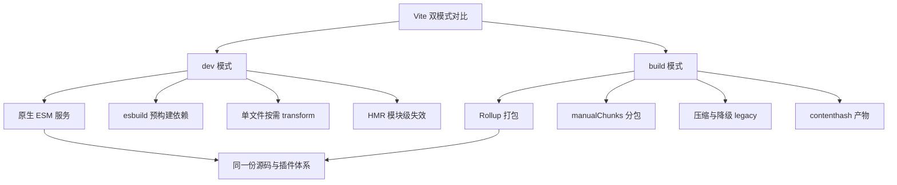

## BLD-100：构建工具专题的知识体系与面试应答策略总结。
**答**：
- 知识四层：原理层（compiler/compilation、Tapable、模块图、HMR runtime、Vite 双引擎）、机制层（loader/pitch、tree-shaking、splitChunks、shared 协商）、优化层（速度与体积的定位-治理-卡口闭环）、工程层（迁移、规范、CI、确定性）。
- 面试应答框架："定义一句话 → 关键流程/参数 → 一个实测数据或踩坑案例 → 边界与选型权衡"；避免只背参数。
- 高频组合题准备：webpack 构建流程 + hooks、HMR 时序 + fallback、contenthash 与缓存、splitChunks 设计、Vite 为什么快、MF 版本协商——这六个覆盖大厂 80% 考察。
- 追问防线：任何方案都能说出"代价是什么"（如 esbuild 快但插件生态弱、MF 灵活但无沙箱）。



```javascript
// vite.config.js：dev 与 build 双模式差异化配置（本图对应落地）
import { defineConfig } from 'vite';
import react from '@vitejs/plugin-react';

export default defineConfig(({ command, mode }) => ({
  plugins: [react()],
  command === 'serve' ? { // dev 专属
    server: { hmr: true, proxy: { '/api': 'http://localhost:7001' } },
    optimizeDeps: { include: ['react', 'react-dom'] },
  } : {                   // build 专属
    build: {
      target: 'es2020',
      rollupOptions: { output: { manualChunks: { 'vendor-react': ['react', 'react-dom'] } } },
      sourcemap: 'hidden',
    },
  },
}));
```

---


## 十一章 webpack 源码级深入（BLD-101 ~ BLD-110）
