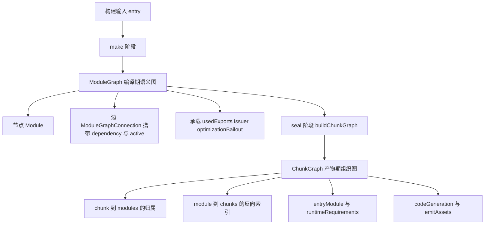

## BLD-105：webpack5 为什么把 ModuleGraph 和 ChunkGraph 拆成两个图？各自存什么？（高频）
**答**：
- webpack4 只有一张"纠缠图"：module 上挂 `chunksIndexes`、chunk 上挂 `modules` 双向数组，任何增删（splitChunks、删模块）都要双向修复，O(n×m) 且易出 bug。
- **ModuleGraph 是编译期语义图**：节点是 Module，边是 `ModuleGraphConnection`（携带 dependency、active、条件），回答"谁依赖谁、issuer 是谁、export 是否被使用（usedByExports）、为什么没被 tree-shake（optimizationBailout）"。
- **ChunkGraph 是产物期组织图**：回答"chunk 包含哪些 module（getChunkModules）、module 进了哪些 chunk、entryModule 是谁、runtimeRequirements 有哪些"；同一个 module 可属于多个 chunk，而依赖关系只存一份。
- 收益：内存与复杂度下降、两阶段职责清晰（make 产出 ModuleGraph，seal 由 buildChunkGraph 从 ModuleGraph 推导出 ChunkGraph）、算法可独立测试——这是 webpack5 架构最常考的一题。



```javascript
// 双图读取：写一个"模块归属报告"插件，理解两个图各自的 API
class GraphReportPlugin {
  apply(compiler) {
    compiler.hooks.thisCompilation.tap('GraphReportPlugin', (compilation) => {
      compilation.hooks.afterSeal.tap('GraphReportPlugin', () => {
        const { moduleGraph, chunkGraph } = compilation;

        // ModuleGraph：回答"谁引用了它 / 它的 export 有没有被用"
        for (const module of compilation.modules) {
          const issuer = moduleGraph.getIssuer(module);               // 引入者
          const incoming = moduleGraph.getIncomingConnections(module); // 入边
          const unusedExports = moduleGraph.getExportsInfo(module)
            ?.getRelevantExports?.([]) ?? [];
          console.log({
            name: module.nameForCondition?.() ?? module.identifier(),
            issuer: issuer?.identifier() ?? 'entry',
            depCount: incoming.length,
          });
        }

        // ChunkGraph：回答"进没进包 / 属于哪个 chunk / runtime 要什么"
        for (const chunk of compilation.chunks) {
          const modules = chunkGraph.getChunkModules(chunk);          // 只读本 chunk 内模块
          const size = modules.reduce((s, m) => s + m.size(), 0);
          console.log({
            chunk: chunk.name ?? chunk.id,
            moduleCount: modules.length,
            sizeKB: (size / 1024).toFixed(1),
            runtimeReqs: [...chunk.runtimeRequirements ?? []].slice(0, 3),
          });
        }
      });
    });
  }
}
module.exports = GraphReportPlugin;
```
