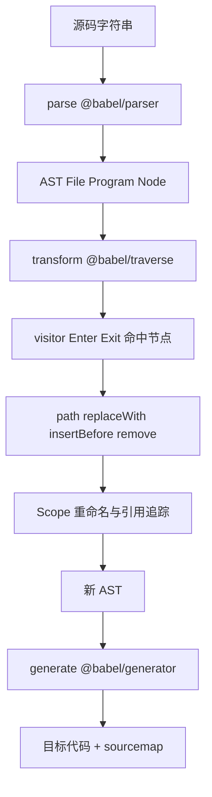

## BLD-119：Babel 编译三阶段：parse → transform → generate 各做什么？
**答**：
- **parse**：`@babel/parser` 把源码字符串解析为 AST（词法/语法两步，输出标准 ESTree 兼容? 实际是 Babel 风格 AST，含 `File > Program > Statement` 树与 start/end/loc 定位）。
- **transform**：`@babel/traverse` 深度优先遍历 AST，插件与 preset 合并后按 visitor 命中节点（Enter/Exit），通过 `path.replaceWith/insertBefore/remove` 改树，并用 Scope 做**重命名与引用追踪**（避免变量冲突）。
- **generate**：`@babel/generator` 把 AST 还原为代码字符串 + sourcemap；`@babel/core` 的 `transformSync` 是三者的编排器，babel-loader 调的就是它。
- 性能与面试要点：plugin 数量与 AST 重建次数线性影响速度；"preset = 插件的集合与排序约定"；transform 阶段的 `code.frame` 报错、`path.hub`? 等细节可作为加分项。



```javascript
// 三阶段拆开跑：理解 babel-core 的编排（等价于 transformSync）
const parser = require('@babel/parser');
const traverse = require('@babel/traverse').default;
const generate = require('@babel/generator').default;
const t = require('@babel/types');

const code = 'const msg = "hello"; console.log(msg.length);';

// ① parse：字符串 → AST
const ast = parser.parse(code, { sourceType: 'module', sourceMaps: true });

// ② transform：AST → 新 AST（示例：把 .length 访问包一层安全函数）
traverse(ast, {
  MemberExpression(path) {
    if (path.node.property.name === 'length' && !path.node.computed) {
      path.replaceWith(
        t.callExpression(t.identifier('safeLen'), [path.node.object])
      );
    }
  },
});

// ③ generate：AST → 代码 + map
const output = generate(ast, { retainLines: false, sourceMaps: true }, code);
console.log(output.code);      // const msg = "hello"; console.log(safeLen(msg));
console.log(output.map);       // sourcemap：转换链要串接（babel-loader 内部处理）
```
