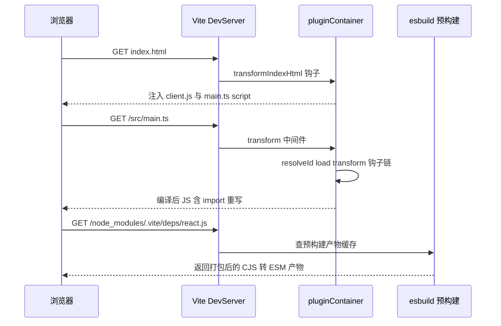

## BLD-129：vite dev 服务启动全流程：createServer 到 transform 中间件链发生了什么？
**答**：
- `createServer(inlineConfig)` 顺序：合并配置 → 创建 `server.moduleGraph`（dev 期的模块图，与 rollup build 期的分离）→ 创建 **pluginContainer**（把插件容器化，提供统一的钩子调用）→ `resolveConfig` 已先跑完 → 初始化 `optimizer`（依赖预构建）。
- 启动链：`createPluginContainer` → 注册中间件（`server.middlewares`：cors → proxy → base → **transform** → static → html fallback）→ listen →（异步）`optimizer.discoverProjectDependencies` 跑 esbuild 扫描与预构建。
- 关键源码文件定位：`packages/vite/src/node/server/index.ts`（createServer）、`server/middlewares/transform.ts`（transformRequest）、`pluginContainer.ts`（rollup 钩子容器）、`optimizer/index.ts`（预构建）。
- 面试画图必备：启动不等待预构建完成，首请求若命中"尚未预构建完的依赖"会返回 `"optimized deps changed. reloading"` 触发 full-reload——这就是首屏偶发自动刷新的根因。



```javascript
// vite.config.ts：把启动流程中的关键节点配齐（对照源码流程）
import { defineConfig } from 'vite';
import vue from '@vitejs/plugin-vue';

export default defineConfig({
  plugins: [vue()],
  server: {
    middlewareMode: false,
    // transform 中间件之前的钩子：配置代理（在 transform 前生效）
    proxy: { '/api': { target: 'http://localhost:7001', changeOrigin: true } },
    watch: { ignored: ['**/node_modules/**', '**/dist/**'] },
  },
  // 预构建：createServer 后异步执行，与首请求赛跑
  optimizeDeps: {
    entries: ['index.html', 'src/**/*.vue'],   // esbuild 扫描入口（收集裸导入）
    include: ['lodash-es'],                    // 动态 import 难以静态分析的补进来
    esbuildOptions: { target: 'es2020', splitting: true }, // 预构建产物能力
  },
  // 启动级 debug：vite --debug transform 看每个请求经过的钩子链
  // 源码阅读入口（node_modules/vite/dist/node/chunks/*.js 打包前源）：
  //   packages/vite/src/node/server/index.ts      createServer
  //   packages/vite/src/node/server/middlewares/transform.ts  transformRequest
  //   packages/vite/src/node/pluginContainer.ts   钩子容器（rollup 钩子适配层）
});
```
