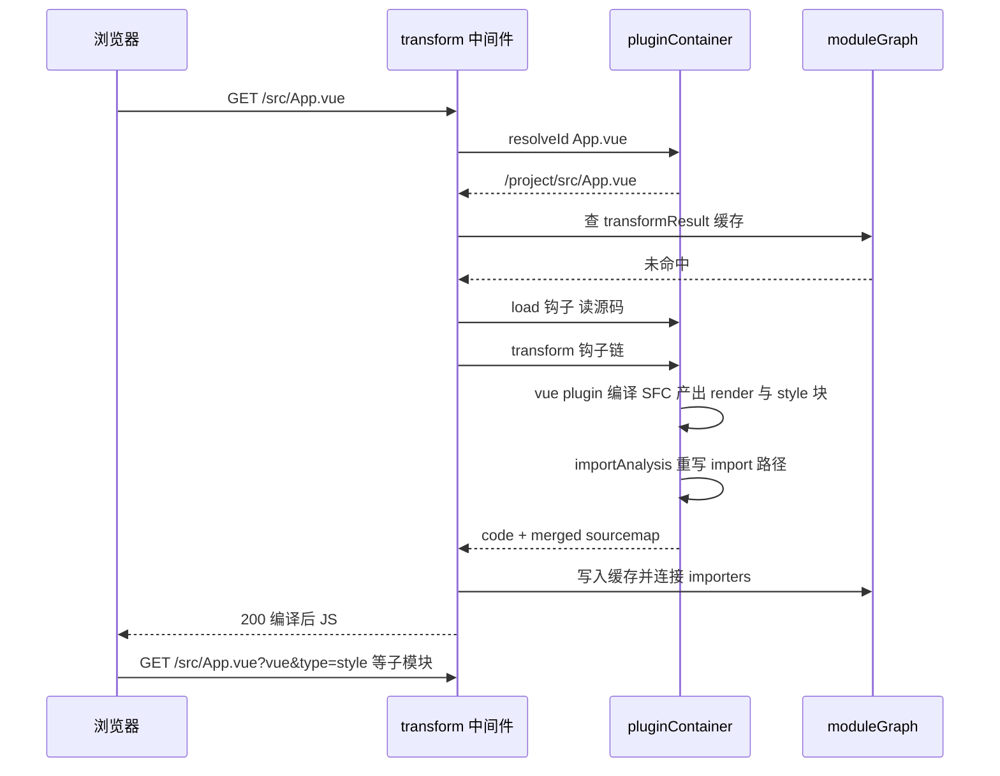

## BLD-133：vite transform 中间件处理一个请求的完整链路（从 index.html 到深层模块）。
**答**：
- 请求进入后按序过中间件：`cors → proxy → base → transform → serveStatic → htmlFallback`；transform 中间件只处理"看起来是模块"的请求（有扩展名或 ?import）。
- transformRequest 内部：`pluginContainer.resolveId(url)` 定位模块 → 查 moduleGraph 的 transformResult 缓存（`?t=` 或文件 mtime 变化则失效）→ `load` 钩子（读文件/virtual module）→ `transform` 钩子链（vue-plugin 编译 SFC → vite 内置的 importAnalysis 重写导入）→ 结果包装成 `TransformResult`（含 MagicString sourcemap 合并）。
- index.html 特殊：`transformIndexHtml` 钩子注入 `/@vite/client`（HMR 客户端）与入口 `<script type="module">`；深链模块（如 `/src/components/Btn.vue?vue&type=style`）由各插件的 transform 产出虚拟子请求。
- 排查手段：`vite --debug transform` 打印每个请求的钩子耗时；`curl 'http://localhost:5173/src/App.vue'` 直接看编译产物。



```javascript
// 最小 transform 中间件复刻：理解 vite 每个请求经过的管线
const middlewares = [
  (ctx) => ctx.accept('text/html'),                 // 1. 识别 html
  async (ctx, next) => {                            // 2. transform 中间件
    const url = decodeURIComponent(ctx.url.split('?')[0]);
    if (url.endsWith('.html')) return next();

    // resolveId：插件容器按逆序调插件的 resolveId（vite 内置 resolvePlugin 最后兜底）
    const id = await container.resolveId(url, undefined, { ssr: false });
    // 缓存判定：?t= 或 moduleGraph 里 mtime 变化 → 强制重编译
    const mod = moduleGraph.getModuleById(id);
    if (mod?.transformResult && !isStale(mod)) return send(ctx, mod.transformResult.code);

    // load：读文件或虚拟模块（virtual:xxx）
    const loadResult = await container.load(id, { ssr: false });
    let code = loadResult?.code ?? fs.readFileSync(cleanUrl(id), 'utf-8');

    // transform：钩子链（vue -> ts -> importAnalysis ...），vite 内部合并 sourcemap
    const result = await container.transform(code, id, { ssr: false });
    moduleGraph.updateModule(mod, result);          // 更新模块图 + importers 连接
    ctx.type = 'application/javascript';            // 统一按 ESM JS 返回
    ctx.body = result.code;
  },
  serveStatic(root),                                // 3. 纯静态兜底（图片等）
];
// 面试落点：dev 下"没有打包"，每个请求独立走 resolveId->load->transform；
// vite:import-analysis 是唯一必经的内置 transform（重写 import）。
```
