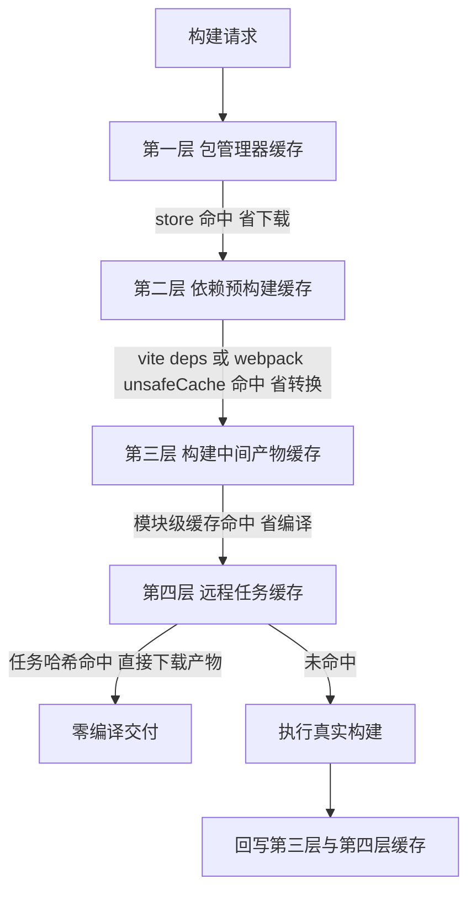

## BLD-157：构建缓存全景：包管理器缓存、依赖缓存、构建中间产物、远程缓存四层怎么协同？
**答**：
- **第一层 包管理器缓存**（pnpm store / npm cache / yarn mirror）：装依赖提速，与构建无关但决定 CI 的"install 时间"；pnpm 全局 store + 硬链接是复用最大化方案。
- **第二层 依赖预构建缓存**（vite 的 `.vite/deps`、webpack 的 resolve/unsafeCache）：把 node_modules 的转换结果存下来，失效靠 lockfile/config hash。
- **第三层 构建中间产物缓存**（webpack filesystem cache、Turbopack dev cache、tsc tsbuildinfo、eslintcache）：模块级/任务级缓存，命中率取决于"输入指纹"设计（配置+文件快照）。
- **第四层 远程缓存**（Turborepo Remote Cache / Nx Cloud / 自建 OSS）：把 CI 产物按任务哈希存取，跨机器/跨人共享——四层的协同是：install 复用 → 预构建复用 → 模块复用 → 任务产物直接命中，任何一层指纹设计错误都会击穿到下一层。



```yaml
# .github/workflows/cache-all-layers.yml：四层缓存的 CI 落法（pnpm + vite 项目）
name: ci
on: pull_request
jobs:
  build:
    runs-on: ubuntu-latest
    steps:
      - uses: actions/checkout@v4
      - uses: pnpm/action-setup@v4
      - uses: actions/setup-node@v4
        with: { node-version: 22, cache: pnpm }         # 第一层：pnpm store 缓存
      # 第二层：vite 预构建缓存（key 含 lockfile hash）
      - uses: actions/cache@v4
        with:
          path: node_modules/.vite
          key: vite-deps-${{ runner.os }}-${{ hashFiles('pnpm-lock.yaml') }}
      # 第三层：tsc 增量与 lint 缓存
      - uses: actions/cache@v4
        with:
          path: |
            .cache/tsbuildinfo
            .eslintcache
          key: intermediate-${{ runner.os }}-${{ github.sha }}-${{ hashFiles('pnpm-lock.yaml') }}
          restore-keys: intermediate-${{ runner.os }}-
      # 第四层：turborepo 远程缓存（签名 + OSS 自建，见 BLD-158）
      - run: pnpm install --frozen-lockfile
      - run: pnpm turbo build --api=http://turbo-cache.internal --token=${{ secrets.TURBO_TOKEN }}
```
