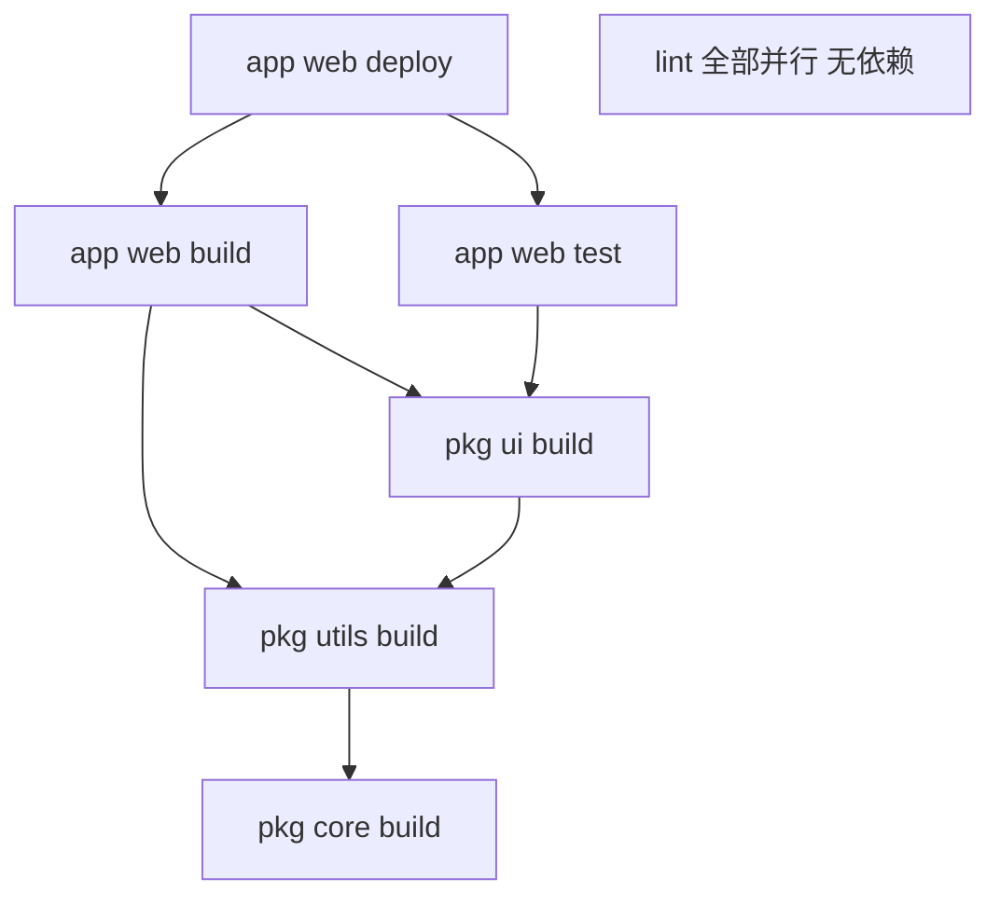

## BLD-174：Monorepo 构建拓扑：turbo 的拓扑管道（dependsOn）怎么设计？（高频）
**答**：
- 拓扑三指令：`dependsOn: ["^build"]`（**我的所有依赖先构建**，^ 表示上游）、`"build"`（同包内串行任务，如先 lint 后 build）、`"app#build"`（指定包任务，打破通用规则）。
- 管道与缓存绑定：dependsOn 决定的执行序同时决定**缓存键的传递**（上游哈希进下游哈希）——所以拓扑错误不仅慢，还会导致缓存内容错误。
- 常见模式：`lint/test` 不依赖构建（可并行抢跑）、`build` 依赖上游 build、`deploy` 依赖 build+test；`check` 聚合任务用 `dependsOn: ["^build", "lint", "test"]`。
- 陷阱：循环依赖直接报错（turbo 会拒绝）；隐式文件级依赖（共享 tsconfig/.env）用 `globalDependencies` 声明进哈希。



```json
// turbo.json：拓扑管道的生产定义（含并行策略）
{
  "$schema": "https://turbo.build/schema.json",
  "globalDependencies": ["tsconfig.base.json", ".eslintrc.cjs", ".env.example"],
  "tasks": {
    "build": {
      "dependsOn": ["^build"],            // 上游依赖先 build（拓扑序）
      "outputs": ["dist/**", ".next/**"],
      "env": ["NODE_ENV", "APP_VERSION"]
    },
    "lint": { "dependsOn": [], "outputs": [] },          // 零依赖：与其他任务并行抢跑
    "test": {
      "dependsOn": ["^build"],            // 测试消费上游 dist
      "outputs": ["coverage/**"]
    },
    "web#deploy": {                        // 指定包级规则：web 的 deploy 前置两个任务
      "dependsOn": ["web#build", "web#test"],
      "cache": false                        // 部署不缓存（副作用任务）
    },
    "check": { "dependsOn": ["lint", "test"] }   // 聚合入口
  }
}
# 执行：turbo run check → lint 全包并行，test/build 按拓扑，deploy 串行收尾
# 验证拓扑：turbo run build --dry=json | jq '.tasks[] | {taskId, dependencies}'
```
