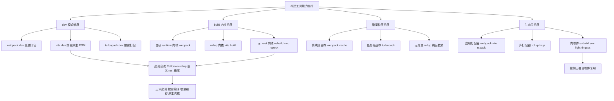

## BLD-200：构建工具知识体系收束：一张图总结 webpack / vite / rollup / esbuild 的能力坐标。
**答**：
- 四维坐标：**dev 模式**（打包型 vs 按需原生 ESM 型）、**build 内核**（自研 runtime vs rollup vs go/rust 内核）、**增量粒度**（模块级/任务级/无）、**生态位**（应用打包器 / 库打包器 / 转译压缩内核）。
- 关系图景：esbuild/swc 是"内核件"（被 vite/webpack/rspack 当零件用）；rollup/vite 是"产物形态最优"（库与 prod）；webpack/rspack/turbopack 是"应用全功能"（生态与 MF）；Rolldown 是"rollup 语义 + rust 速度"的合流点。
- 面试终局答法：不背工具名，讲"**按需编译 + 增量缓存 + 原生内核**"三大趋势如何解释所有工具的演进（Vite 的快、Turbopack 的函数级缓存、Rspack 的兼容层都是这三点的不同实现比例）。
- 决策收束：库 → rollup 系；应用 dev 体验优先 → vite 系；应用生态/存量优先 → webpack/rspack 系；一切以"度量 + 团队能力 + 回滚路径"三要素落地。



```javascript
// 选型速查表（面试可直接背的"一行答案"）
const DECISION = {
  'npm 库': 'tsup / unbuild（rollup 语义）+ 双 exports',
  '新 SPA（React/Vue）': 'Vite（dev 按需 ESM + build rollup/Rolldown）',
  '重 SSR 应用': 'Next/Nuxt 全家桶（Turbopack / Vite），不自己组链路',
  '存量 webpack 大仓': 'Rspack 渐进迁移（兼容层 + 度量 + 双轨回滚）',
  '微前端基座': 'webpack/Rspack（MF 成熟度）+ 依赖治理（BLD-187）',
  '自定义转译/压缩': 'esbuild/swc 做内核件，别脱离宿主打包器单干',
};
// 一句话总结：所有现代工具都在回答同一个问题——
// "怎么让编译只发生在被需要的地方（按需），且只算一次（增量），算得够快（原生内核）"。
```

> 本文件完整收录 BLD-001 ~ BLD-200 共 200 题：第 1-10 章为 webpack 原理与优化主线，第 11-20 章为源码级深入、多工具实践与综合实战。
