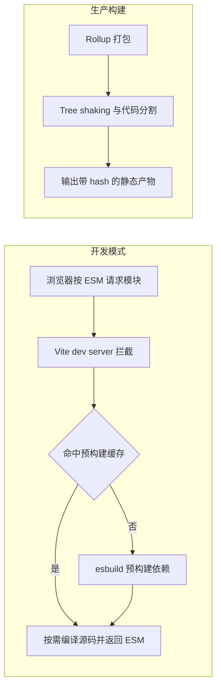

## ENG-008：npm scripts 的生命周期钩子是怎么执行的？
**答**：
- 任意自定义脚本 name 会先自动执行 prename 再执行 postname，例如 build 前后钩子。
- 内置生命周期：prepare 在本地开发与打包前执行（husky 常挂这里）、prepublishOnly 在发布前执行。
- 钩子是隐式魔法，团队内要控制使用密度，过多 pre/post 会让调用链难以追踪。
- 脚本里可以通过 npm_package_* 环境变量读取包信息。

```javascript
// package.json
{
  "scripts": {
    // 执行 pnpm build 时自动按序执行 prebuild -> build -> postbuild
    "prebuild": "rimraf dist",
    "build": "vite build",
    "postbuild": "node scripts/print-size.mjs",
    // prepare：安装依赖后自动执行，husky 靠它注册 git hooks
    "prepare": "husky",
    // 发布前校验，失败则中止 npm publish
    "prepublishOnly": "pnpm test && pnpm build"
  }
}
```

---

## 第二章 Vite 原理与实践（ENG-009 ~ ENG-014）


