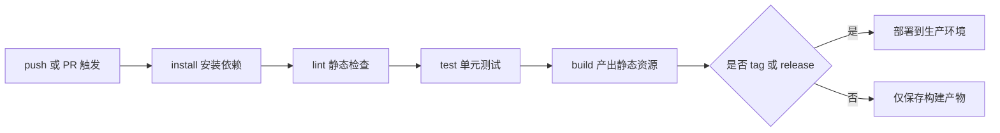

## ENG-039：stash 和 bisect 分别解决什么问题？
**答**：
- stash 临时保存未提交的工作区改动，切分支处理紧急问题后再 pop 回来。
- bisect 用二分法在提交历史中定位"第一个引入 bug 的提交"，把 O(n) 排查变成 O(log n)。
- 流程：标记当前 bad 与某个已知 good，Git 自动检出中间提交，测试后标记，最终定位。
- bisect run 还可以挂自动化测试脚本全自动二分。

```bash
# stash：临时保存工作区
git stash push -m "wip: 首页改版"
git stash list
git stash pop

# bisect：二分定位坏提交
git bisect start
git bisect bad HEAD
git bisect good v1.0.0
# 每次检出后测试并标记 good/bad，结束后复位
git bisect reset
```

---

## 第八章 CI CD（ENG-040 ~ ENG-043）


