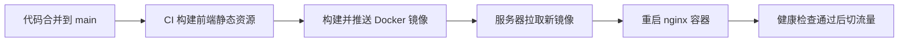

## ENG-053：Monorepo 中如何用 changesets 管理版本发布？
**答**：
- changesets 把"版本决策"变成提交内容：每次 PR 附带一个 changeset 文件记录变更意图与 semver 级别。
- pnpm changeset version 消费所有待发布 changeset：升级版本、更新互相依赖、生成 CHANGELOG。
- CI 中的 changesets/action 检测到待发布包时自动创建"版本 PR"，合并后自动 publish。
- 对 monorepo 特别友好：只发有变化的包，内部依赖版本联动。

```bash
# 安装并初始化
pnpm add -Dw @changesets/cli
pnpm changeset init

# 开发时交互式记录变更意图，生成 .changeset/*.md
pnpm changeset

# 合并前统一升级版本并更新 CHANGELOG
pnpm changeset version

# CI 中发布所有待发布的包
pnpm changeset publish
```

---

## 第十三章 Docker 与 Nginx 部署（ENG-054 ~ ENG-056）


