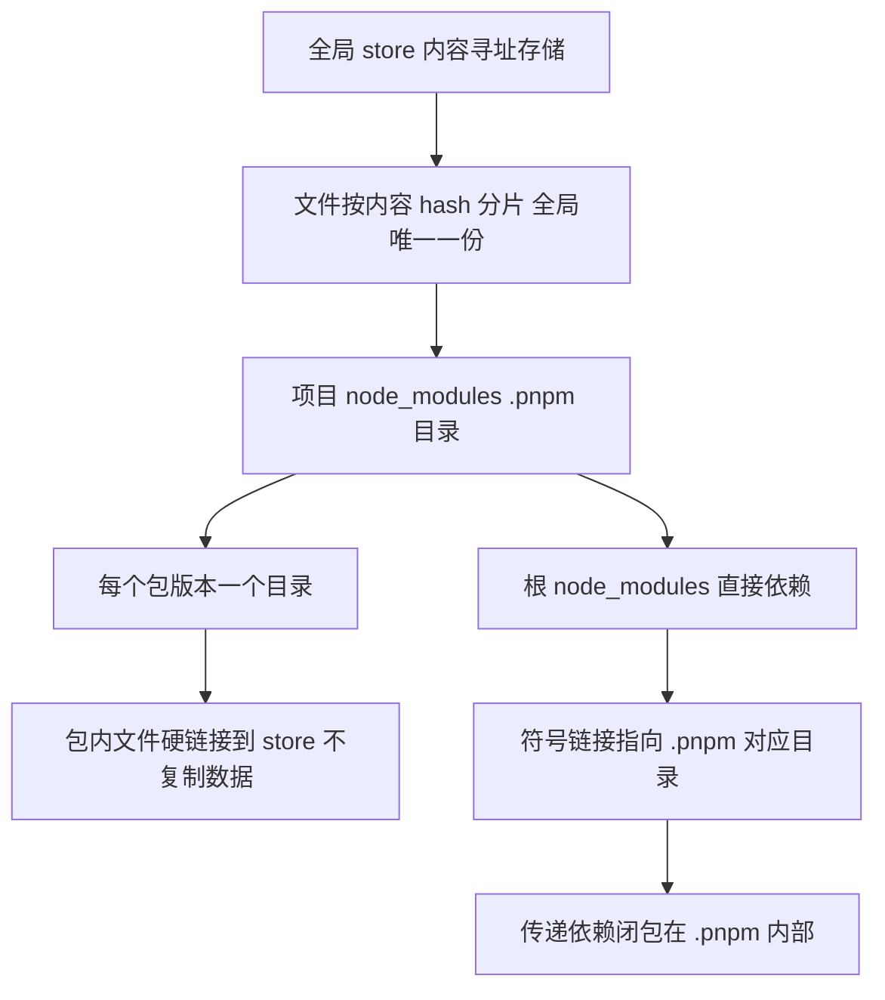

## ENG-060：AI 生成代码在 review 与安全上要注意什么？
**答**：
- 幻觉包投毒：AI 建议安装的 npm 包可能不存在或名字相近的恶意包，装包前必须到 registry 核实。
- 凭证安全：对话中禁止粘贴真实密钥、内网地址与生产数据；发现生成代码里有硬编码凭证必须打回。
- 供应链与合规：新增依赖过 pnpm audit 与 license 审查；AI 生成代码同样不能引入不兼容协议的代码片段。
- 责任边界：AI 代码按"新人提交"对待，reviewer 逐行理解后才能 approve，不允许无 review 直接合入。

```bash
# 1. 核实 AI 建议的包真实存在，防幻觉包
npm view some-ai-suggested-pkg version

# 2. 扫描生成代码中是否泄漏敏感信息
grep -rnE "(api[_-]?key|secret|password)" src/ || echo "未发现明文凭证"

# 3. 与人工代码同一门禁
pnpm lint && pnpm test && pnpm build

# 4. 依赖安全审计
pnpm audit --prod
```

---

## 第十六章 包管理深水区（ENG-061 ~ ENG-066）


