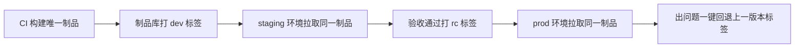

## ENG-096：制品管理与晋级怎么做？为什么要"同一制品晋级"？


**答**：
- 原则：dev→staging→prod 每个环境部署的必须是同一个二进制/镜像，只改环境配置，绝不在各环境重新构建。
- 重新构建的风险：三次构建的依赖时点可能不同，staging 验证过的东西到 prod 就"不是同一个东西"。
- 落地：CI 构建一次进制品库（Harbor/Artifactory），部署 job 只做"拉取指定版本 + 注入环境配置"。
- 晋级即打标：通过 staging 验收后加 rc 标签晋级 prod，回滚就是回退到上一个版本标签，秒级完成。


```yaml
# 同一制品晋级：build 产出镜像，staging 与 prod 只引用镜像版本
jobs:
  build:
    outputs:
      image: ${{ steps.meta.outputs.image }}
    steps:
      - run: docker build -t app:sha-${{ github.sha }} .
      - id: meta
        run: echo "image=app:sha-${{ github.sha }}" >> "$GITHUB_OUTPUT"

  deploy-staging:
    needs: build
    steps:
      - run: kubectl set image deploy/app app=${{ needs.build.outputs.image }} # 同一镜像

  deploy-prod:
    needs: [build, deploy-staging]
    environment: production      # 人工审批门
    steps:
      - run: kubectl set image deploy/app app=${{ needs.build.outputs.image }} # 仍是同一镜像
```
