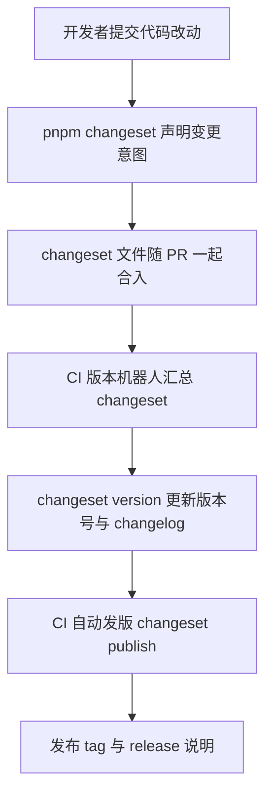

## ENG-108：changesets 的版本发布全流程是怎样的？


**答**：
- changesets 的心智模型："变更意图"与"代码"一起提交：PR 里跑 pnpm changeset 选 patch/minor/major 并写摘要。
- 汇总发版：CI 机器人发现 main 上有未消费的 changeset，创建 "Version PR" 汇总更新所有版本号与 CHANGELOG。
- 合并 Version PR 后自动 publish：按依赖拓扑发布受影响包，内部包引用（workspace:^）同步升版本。
- 双刃剑提醒：changeset 忘写不会报错，可在 PR 检查里校验"改了 packages/ 必须带 changeset"。


```bash
# 1. PR 中声明变更意图：选择 bump 类型并写摘要
pnpm changeset
# 生成 .changeset/xxx-yyy.md：
# ---
# '@myorg/ui': minor
# ---
# Button 组件新增 loading 属性

# 2. CI 汇总发版（Version PR 被合并后触发）
pnpm changeset version      # 更新版本号与 CHANGELOG.md
pnpm changeset publish      # 按拓扑序发布所有变更包
git push --follow-tags      # 推送发布 tag
```
