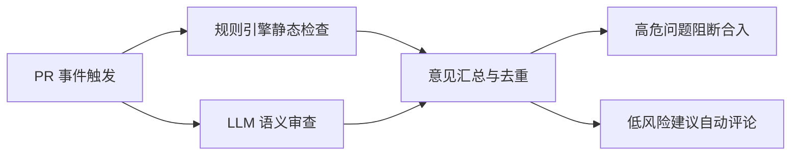

## ENG-117：研发效能看板怎么搭建？
**答**：
- 数据源三路：git 事件（commit/MR）、CI 事件（运行/部署）、issue 事件（故障/需求流转），统一进数仓表。
- 看板分两层：团队层看 DORA 与 CI 健康度；工程层看代码质量趋势（覆盖率、重复率、技术债存量）。
- 指标呈现强调趋势与对比（本周 vs 上季度），单点数字没有诊断价值。
- 运营机制：双周效能回顾会，看板只回答三个问题——哪慢了、哪不稳了、哪在恶化。

```sql
-- 效能看板聚合：CI 健康度按周统计
SELECT
  date_trunc('week', started_at) AS week,
  count(*) FILTER (WHERE conclusion = 'failure')::float / count(*) AS failure_rate,
  percentile_cont(0.95) WITHIN GROUP (ORDER BY duration_sec) AS p95_duration_sec,
  count(DISTINCT repo) AS active_repos
FROM pipeline_runs
WHERE workflow = 'ci'
  AND started_at > now() - interval '13 weeks'
GROUP BY 1
ORDER BY 1 DESC;
```

---

## 第二十五章 AI 工程化与新范式（ENG-118 ~ ENG-130）


