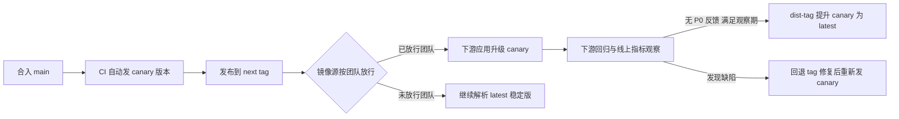

## ENG-139：灰度发布的工程实现是什么？canary 版本与 next tag 怎么联动？
**答**：
- npm 生态的灰度 = canary 版本 + next tag：合入 main 自动发 x.y.z-canary.sha，下游应用显式升级才算进入灰度。
- 灰度闭环：上游发 canary → 下游关键应用升级验证 → 反馈 issue → 满足观察期后 dist-tag 提到 latest。
- 内部镜像源可做得更细：verdaccio 按团队放行 canary tag，未放行团队继续解析 latest，风险面可控。
- 转正条件量化写进流程：无 P0/P1 反馈满 N 天 + 覆盖调用方冒烟通过。



```yaml
# .github/workflows/canary.yml —— 合入 main 自动发 canary
name: canary-release
on:
  push:
    branches: [main]
jobs:
  canary:
    runs-on: ubuntu-latest
    if: "!contains(github.event.head_commit.message, '[skip canary]')"
    steps:
      - uses: actions/checkout@v4
        with: { fetch-depth: 0 }
      - uses: pnpm/action-setup@v4
      - uses: actions/setup-node@v4
        with: { node-version: 22, registry-url: https://verdaccio.corp.internal }
      - run: pnpm install --frozen-lockfile && pnpm build
      - name: 发 canary 版本
        run: |
          SHA=$(git rev-parse --short HEAD)
          pnpm version prerelease --preid=canary.$SHA --no-git-tag-version
          npm publish --tag next
        env:
          NODE_AUTH_TOKEN: ${{ secrets.CORP_NPM_TOKEN }}
```
