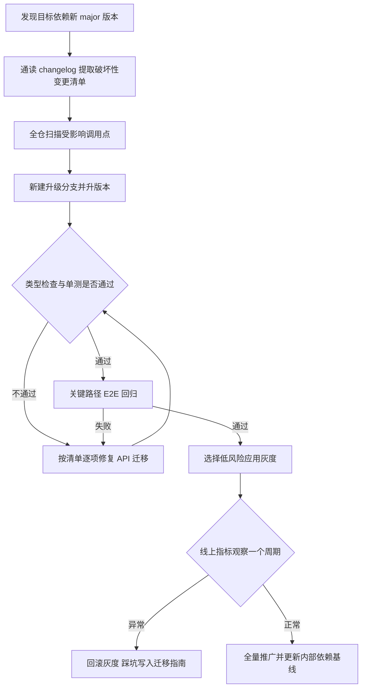

## ENG-149：破坏性升级怎么评估？变更日志 影响面 灰度的完整流程？
**答**：
- major 升级不能只看 changelog 拍板：走四步 变更清单 → 影响面扫描 → 迁移验证 → 灰度全量。
- 影响面扫描：grep 调用点统计工作量 + 升级后 tsc --noEmit 暴露签名不匹配 + E2E 关键路径回归。
- 灰度策略：先升一个低风险内部应用，线上指标观察一个发布周期，异常即回滚并把踩坑写进迁移指南。
- 全量推广后更新内部依赖基线（catalog/版本矩阵），防止后续项目又引入旧版本。



```bash
# 影响面扫描与迁移验证实操
# 1. 扫描调用点 数量决定工作量评估
grep -rn "from 'lodash'" src/ | wc -l

# 2. 升级后先用类型检查暴露破坏面
pnpm add lodash@4.17.21 --save-exact
pnpm tsc --noEmit 2>&1 | tee /tmp/upgrade-issues.log

# 3. 统计错误数量 判断升级成本
grep -c "error TS" /tmp/upgrade-issues.log
```
