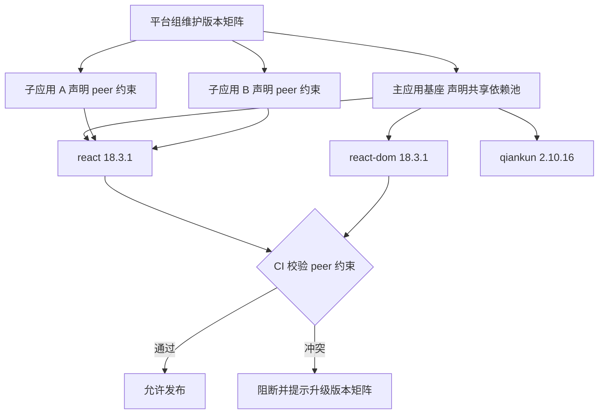

## ENG-154：微前端的工程配套怎么做？共享依赖构建 版本协调 发布顺序怎么管理？
**答**：
- 微前端最贵的不是运行时方案，是工程配套：共享依赖谁提供、版本怎么协调、子应用发布顺序如何约束。
- 共享依赖矩阵是单一事实源：主应用提供 react 等基座依赖，子应用只声明 peer 约束，矩阵由平台组维护进配置包。
- 发布顺序契约：基座先于子应用发布，子应用之间解耦可乱序；基座接口变更走 deprecate 周期。
- CI 强制校验：子应用构建期对共享依赖做 peer 约束检查，冲突即阻断，不允许带病上线。



```json
// packages/micro-shared/versions.json —— 共享依赖版本矩阵 单一事实源
{
  "shared": {
    "react": { "version": "18.3.1", "peer": "^18.0.0", "singleton": true, "strictVersion": true },
    "react-dom": { "version": "18.3.1", "peer": "^18.0.0", "singleton": true, "strictVersion": true },
    "qiankun": { "version": "2.10.16", "singleton": true },
    "dayjs": { "version": "1.11.13", "singleton": false }
  },
  "releaseOrder": { "base": "first", "subApps": "independent" },
  "policy": "strictVersion 冲突在 CI 构建期报错 不允许带病上线"
}
```
