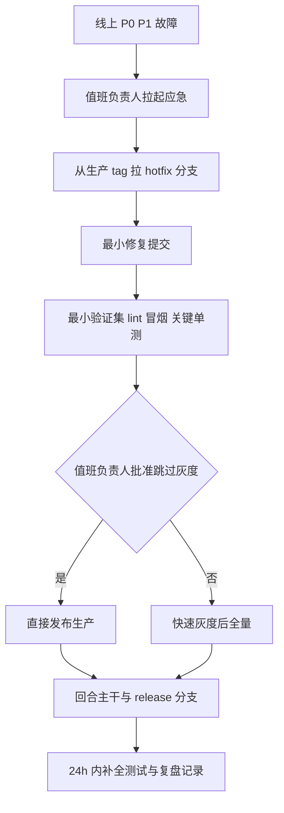

## ENG-166：紧急修复流程怎么设计？hotfix 快速通道与追踪怎么做？
**答**：
- 热修复通道独立于常规流水线：不排队、并行跑最小验证集（lint + 冒烟 + 关键单测），全程留痕事后补全。
- 四步流程：从生产 tag 拉 hotfix 分支 → 修复与最小回归 → 发布（跳灰度需值班负责人批准）→ 回合主干与 release 分支。
- 复盘必做：hotfix 频率超阈值（如每月 5 次）说明常规质量门禁失效，要回溯原因而非继续救火。
- 所有 hotfix 带独立标签，发布记录与故障单双向关联，追踪闭环。



```bash
# hotfix 快速通道实操
git fetch origin && git checkout -b hotfix/PROJ-5678-payment-timeout v2.3.1
# ... 最小修复 ...
git commit -m "fix: PROJ-5678 支付超时重试风暴 修复幂等键生成"
git push origin hotfix/PROJ-5678-payment-timeout
# 触发应急流水线 独立 workflow 不排队
gh workflow run hotfix.yml -f branch=hotfix/PROJ-5678-payment-timeout -f skip_gray=false
# 修复回合主干
git checkout main && git cherry-pick <fix-commit> && git push origin main
```
