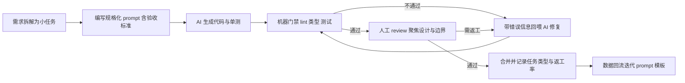

## ENG-177：AI 结对编程的工作流怎么设计？任务拆分 生成 审查 合并的闭环？
**答**：
- 把 AI 当高速 junior 管理：人拆任务到 PR 粒度 → 写规格化 prompt（含验收标准）→ AI 生成 → 机器门禁 → 人工 review → 合并。
- 任务拆分原则：一次一件事（一个函数/一个组件），上下文给足（相关类型 + 相似已有实现作 few-shot）。
- 失败回喂：门禁报错直接回喂 AI 修复，闭环收敛；连续失败超 N 次转人工。
- 度量闭环：记录各任务类型的返工率与 review 耗时，数据回流迭代 prompt 模板，返工率高的类型改回人工。



```yaml
# .ai/workflows/feature.yaml —— AI 结对任务规格模板
task:
  id: FE-2026-0876
  type: component           # component | hook | util | page
  prompt_ref: .ai/prompts/component.md
  context:                  # 生成前必须喂给模型的上下文
    - src/components/Table/Column.tsx      # 相似已有实现作 few-shot
    - src/types/order.d.ts                 # 相关类型定义
  constraints:
    - 使用 @corp/ui 现有组件 不重复造轮子
    - 禁止引入新依赖
    - 单测用 vitest 与 testing-library 覆盖交互路径
  acceptance:
    - 列配置为空时展示空态
    - 排序事件触发 onSortChange 并带列 key
    - 覆盖率不低于 85%
```
