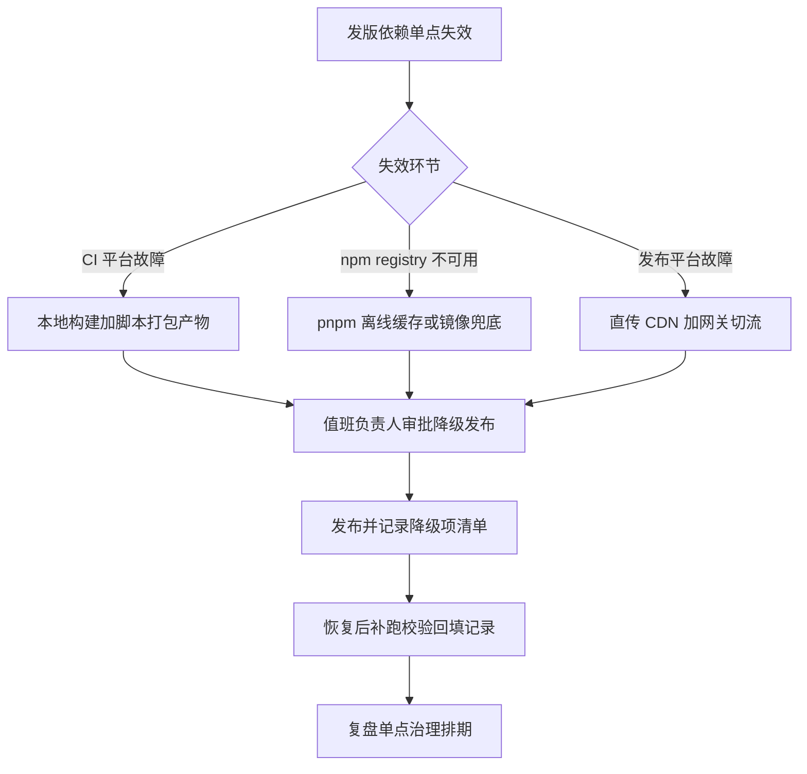

## ENG-191：灾难恢复预案怎么设计？构建系统挂了怎么发版？
**答**：
- 预案核心：列出发版依赖链上每个单点（CI registry 镜像 CDN 发布平台），每个单点给绕行方案与切换时间。
- 最小发版路径：本地构建 + 手动上传 CDN + 网关切流；允许降级跳过部分自动校验，但降级项必须记录事后补齐。
- 演练制度：季度断供演练（模拟 CI 挂两小时），把 runbook 从文档变成肌肉记忆。
- 恢复后动作：补跑完整性校验 回填构建记录 复盘单点问题排期治理。



```bash
# runbook/emergency-release.sh —— 断供应急发版半人工兜底
set -euo pipefail
pnpm install --offline --frozen-lockfile          # registry 不可用时离线安装
pnpm build                                        # 本地构建

# 产物完整性自检 替代 CI 校验
node scripts/verify-reproducible.sh

# 直传 CDN 并灰度切流 凭证来自应急工单
aws s3 cp dist/ "s3://corp-static/emergency-$(date +%m%d)/" --recursive
curl -X POST https://gateway.corp.com/admin/switch \
  -H "Authorization: Bearer $EMERGENCY_TOKEN" \
  -d "{\"app\":\"mall\",\"target\":\"emergency-$(date +%m%d)\",\"gray\":\"5%\"}"
echo "降级发布完成 恢复后请回填 CI 构建记录并复盘"
```
